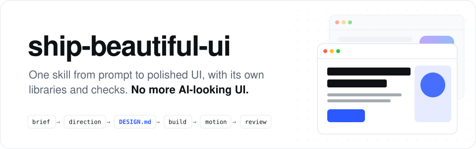

<p align="center">
  <picture>
    <source media="(prefers-color-scheme: dark)" srcset="assets/readme/header-dark.svg">
    
  </picture>
</p>

<p align="center">
  <b>One skill that takes your coding agent from prompt to polished UI.<br>Its own design libraries, its own checks, and designs that come from your subject, not a template.</b>
</p>

<p align="center">
  <a href="LICENSE"></a>
  <a href="skills/ship-beautiful-ui/SKILL.md"></a>
  
  
  <a href="https://github.com/Vedmeena21/ship-beautiful-ui/stargazers"></a>
  <a href="https://www.linkedin.com/in/ved-prakash-meena"></a>
</p>

<p align="center">
  <a href="#install">Install</a> ·
  <a href="#how-it-works">How it works</a> ·
  <a href="#design-from-your-subject">Design from your subject</a> ·
  <a href="#whats-inside">What's inside</a> ·
  <a href="#the-detector">The detector</a>
</p>

| Typical AI first draft | Built with ship-beautiful-ui |
|:---:|:---:|
|  |  |

---

## Why this exists

Coding agents can write a whole frontend in minutes, and it still comes out looking like every other AI-built page: the same font, the same purple gradient, the same row of three identical cards, the same fade-up on every section.

That happens because the agent starts from the same defaults every time. **ship-beautiful-ui** replaces those defaults with a process, real design data, and checks that run on the result:

- **A process.** Brief → direction → lock → build → motion → review, always in that order.
- **Design from your subject.** The palette comes from things in your product's own world (a bakery's crust and flour, a darkroom's safelight red), not from a list everyone shares.
- **One source of truth.** Every visual decision is written into `DESIGN.md` before any code, and checked.
- **Checks, not vibes.** A 40-rule detector scans the code for AI tells and accessibility gaps before handoff.

No dependencies. The scripts are plain Python 3.

## Install

**Any agent (Claude Code, Codex, Cursor and more)** via the [`skills`](https://github.com/vercel-labs/skills) CLI:

```bash
npx skills add Vedmeena21/ship-beautiful-ui
```

**Claude Code plugin:**

```
/plugin marketplace add Vedmeena21/ship-beautiful-ui
/plugin install ship-beautiful-ui@ship-beautiful-ui
```

**Manual:** copy [`skills/ship-beautiful-ui`](skills/ship-beautiful-ui) into `.claude/skills/` (project) or `~/.claude/skills/` (global).

**Then just ask for UI.** The skill starts on its own when you build, redesign or polish a page, screen or component:

```
Build a landing page for an invoicing tool for freelance photographers.
The one job: send a first invoice in under 2 minutes. Next.js + Tailwind.
```

```
This dashboard looks generic. Use ship-beautiful-ui to redesign it.
```

You get three things back:

| Output | What it is |
|---|---|
| `DESIGN.md` | Your design system: tokens and rules any agent can read, checked for contrast |
| The UI | Built only from `DESIGN.md` tokens |
| `REVIEW.md` | What the detector found, what was fixed, what was kept and why |

## How it works

<p align="center">
  
</p>

| Step | What happens | Built in |
|---|---|---|
| **0. Brief** | Subject, audience, the one job of the screen, five nouns from the subject's world | [`00-brief.md`](skills/ship-beautiful-ui/references/00-brief.md) |
| **1. Direction** | A palette, type pairing and layout made for this subject | `derive.py`, `direction.py`, 78 materials, 60 palettes, 40 pairings, 20 layouts |
| **2. Lock** | Every decision written into `DESIGN.md` and checked | `lint_design.py`, [`DESIGN.md` template](skills/ship-beautiful-ui/templates/DESIGN.md) |
| **3. Build** | Tokens only, one bold idea, the quality floor | [`effects.md`](skills/ship-beautiful-ui/references/effects.md) (16 effects), [`ux-rules.md`](skills/ship-beautiful-ui/references/ux-rules.md) (80 rules) |
| **4. Motion** | Only motion that explains a change | [`04-motion.md`](skills/ship-beautiful-ui/references/04-motion.md): timing tokens and 12 recipes |
| **5. Review** | One gate before handoff | `detect.py` (40 rules), screenshots, [`REVIEW.md`](skills/ship-beautiful-ui/templates/REVIEW.md) |

**Who wins when instructions disagree:** your words > `DESIGN.md` > the skill's rules > anything else loaded. The agent says it out loud when it resolves a conflict, so you can overrule it.

## Design from your subject

Most design generators pick from a shared list, which is why their results start to look alike. `derive.py` builds the palette from your subject's own world instead, then fixes contrast so it passes WCAG AA:

```
$ python3 scripts/derive.py --words "darkroom safelight, contact sheet, grey card, film edge"
From: safelight-red (accent), contact-sheet (ink), grey-card (neutral), film-rebate (accent)

  base       #F7F7F3
  surface    #FCFCFA
  ink        #141414
  muted      #70706F
  line       #D7D7D4
  accent     #B3261E
  on-accent  #FFFFFF
  accent-2   #C27E19

Contrast: ink/base 17.15  muted/base 4.62  muted/surface 4.83  on-accent/accent 6.54  accent/base 6.09
```

```
$ python3 scripts/derive.py --words "bakery crust, flour, espresso, saffron"
  base #F5F2EA   ink #3B2418   accent #A0522D   accent-2 #C37C0A
```

Two products can't land on the same look by accident, because each starts from its own world. When a subject has no strong visual world, `direction.py` deals three options from the library instead, and the same brief always gets the same options.

## What's inside

| Library | Count | |
|---|---|---|
| Materials from subjects' worlds | **78** | paper, film, food, nature, craft, screens, money, care, play, travel |
| Palettes, light and dark | **60** | every one contrast-checked by the tests |
| Type pairings | **40** | all free Google Fonts, with roles and usage notes |
| Layout patterns | **20** | with wireframes: product proof, editorial column, dashboard focus, honest pricing and more |
| Effects | **16** | plain CSS/JS, recolored by tokens, each with a reduced-motion fallback |
| Motion recipes | **12** | plus timing tokens for every interface transition |
| UX rules | **80** | layout, type, color, forms, navigation, states, tables, charts, mobile, accessibility, copy |
| Detector rules | **40** | AI tells plus accessibility and quality-floor gaps |

| Script | Does |
|---|---|
| `derive.py` | Words from your subject → contrast-checked palette |
| `direction.py` | Product kind + brief → 3 direction options → `DESIGN.md` draft |
| `lint_design.py` | Checks `DESIGN.md`: structure, section order, token references, contrast |
| `detect.py` | Scans HTML, CSS, JS/TS, JSX/TSX, Vue, Svelte and Astro for the 40 rules |

## The detector

```
$ python3 scripts/detect.py src/
SBU001 warning One generic sans for everything
SBU002 warning Purple-to-blue gradient
SBU010 error   Motion without reduced-motion support
SBU011 error   Focus outline removed
SBU013 warning Cream page + terracotta accent
...
Scanned 1 files: 6 errors, 10 warnings, 5 info
```

Every finding comes with a fix. Errors block handoff; warnings get fixed or a written reason in `REVIEW.md`. The full list, plus 12 visual defaults the agent checks by eye, is in [`anti-patterns.md`](skills/ship-beautiful-ui/references/anti-patterns.md).

## License

[MIT](LICENSE). Built and maintained by **Ved Prakash Meena**.

<a href="https://www.linkedin.com/in/ved-prakash-meena"></a>

<p align="center">
  <sub>If this saved you a round of "make it look less AI", a ⭐ helps others find it, and <a href="https://www.linkedin.com/in/ved-prakash-meena">follow me on LinkedIn</a> for more.</sub>
</p>
