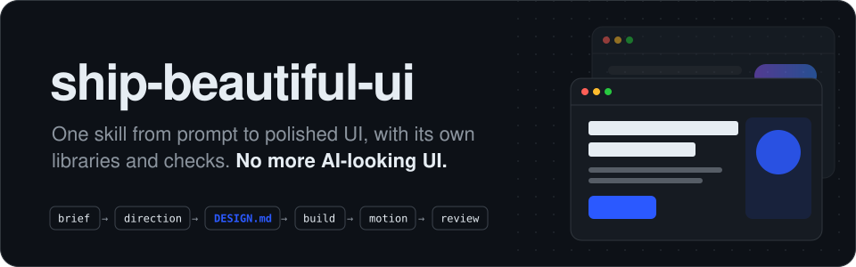

<p align="center">
  
</p>

```bash
npx skills add Vedmeena21/ship-beautiful-ui
```

<p align="center">
  <a href="../../LICENSE"></a>
  <a href="../../skills/ship-beautiful-ui/SKILL.md"></a>
  
  
  <a href="https://github.com/Vedmeena21/ship-beautiful-ui/stargazers"></a>
  <a href="../../translations"></a>
</p>

<p align="center">
  <a href="#التثبيت">التثبيت</a> ·
  <a href="#كيف-يعمل">كيف يعمل</a> ·
  <a href="#علامتك-التجارية-وألوانك">علامتك التجارية، وألوانك</a> ·
  <a href="#ماذا-بالداخل">ماذا بالداخل</a>
</p>

| المسودة الأولى المعتادة من الذكاء الاصطناعي | مبني باستخدام ship-beautiful-ui |
|:---:|:---:|
|  |  |

<details>
<summary>🌐 دعم متعدد اللغات</summary>

[English](../../README.md) | [Arabic](../ar/README.md) | [Chinese (Simplified)](../zh/README.md) | [French](../fr/README.md) | [German](../de/README.md) | [Hindi](../hi/README.md) | [Indonesian](../id/README.md) | [Japanese](../ja/README.md) | [Korean](../ko/README.md) | [Portuguese (Brazil)](../pt-BR/README.md) | [Russian](../ru/README.md) | [Spanish](../es/README.md) | [Turkish](../tr/README.md)

</details>

---

## لماذا وُجد هذا المشروع

وكلاء البرمجة يكتبون واجهة أمامية كاملة في دقائق، ومع ذلك تبدو النتيجة مثل كل صفحة أخرى صنعها الذكاء الاصطناعي: الخط نفسه، التدرج البنفسجي نفسه، صف من ثلاث بطاقات متطابقة، وحركة الظهور من الأسفل نفسها في كل قسم.

يحدث هذا لأن الوكيل يبدأ في كل مرة من الإعدادات الافتراضية نفسها. يستبدل **ship-beautiful-ui** هذه الإعدادات بعملية واضحة، وبيانات تصميم حقيقية، وفحوصات تعمل على النتيجة:

- **عملية واضحة.** الملخص ← الاتجاه ← التثبيت ← البناء ← الحركة ← المراجعة، دائمًا بهذا الترتيب.
- **تصميم ينبع من موضوعك.** تأتي الألوان من عالم منتجك نفسه (قشرة الخبز والدقيق في مخبز، أو أحمر ضوء الأمان في غرفة التحميض)، لا من قائمة يشترك فيها الجميع.
- **مصدر واحد للحقيقة.** كل قرار بصري يُكتب في `DESIGN.md` قبل أي كود، ثم يُفحص.
- **فحوصات، لا انطباعات.** كاشف من 40 قاعدة يفحص الكود بحثًا عن علامات الذكاء الاصطناعي وثغرات إمكانية الوصول قبل التسليم.

بلا أي اعتماديات. السكربتات مكتوبة بلغة Python 3 العادية.

## التثبيت

**أي وكيل (Claude Code وCodex وCursor وغيرها)** عبر أداة [`skills`](https://github.com/vercel-labs/skills) CLI:

```bash
npx skills add Vedmeena21/ship-beautiful-ui
```

**إضافة Claude Code:**

```
/plugin marketplace add Vedmeena21/ship-beautiful-ui
/plugin install ship-beautiful-ui@ship-beautiful-ui
```

**يدويًا:** انسخ [`skills/ship-beautiful-ui`](../../skills/ship-beautiful-ui) إلى `.claude/skills/` (للمشروع) أو `~/.claude/skills/` (عام).

**بعدها اطلب واجهة فحسب.** تبدأ الـ skill من تلقاء نفسها عندما تبني صفحة أو شاشة أو مكوّنًا، أو تعيد تصميمه أو تصقله:

```
ابنِ صفحة هبوط لأداة فواتير للمصورين المستقلين.
المهمة الوحيدة: إرسال أول فاتورة في أقل من دقيقتين. Next.js + Tailwind.
```

```
هذه اللوحة تبدو عادية. استخدم ship-beautiful-ui لإعادة تصميمها.
```

تحصل على ثلاثة أشياء:

| المخرج | ما هو |
|---|---|
| `DESIGN.md` | نظام التصميم الخاص بك: رموز وقواعد يقرؤها أي وكيل، مع فحص التباين |
| الواجهة | مبنية فقط من رموز `DESIGN.md` |
| `REVIEW.md` | ما وجده الكاشف، وما أُصلح، وما بقي ولماذا |

## كيف يعمل

<p align="center">
  
</p>

| الخطوة | ماذا يحدث | مضمّن |
|---|---|---|
| **0. الملخص** | الموضوع، الجمهور، المهمة الوحيدة للشاشة، خمس كلمات من عالم الموضوع | [`00-brief.md`](../../skills/ship-beautiful-ui/references/00-brief.md) |
| **1. الاتجاه** | لوحة ألوان وزوج خطوط وتخطيط مصنوعة لهذا الموضوع | `derive.py`, `direction.py`, 78 خامة، 60 لوحة ألوان، 40 زوج خطوط، 20 تخطيطًا |
| **2. التثبيت** | كل قرار يُكتب في `DESIGN.md` ويُفحص | `lint_design.py`, [قالب `DESIGN.md`](../../skills/ship-beautiful-ui/templates/DESIGN.md) |
| **3. البناء** | رموز فقط، فكرة جريئة واحدة، حدّ أدنى للجودة | [`effects.md`](../../skills/ship-beautiful-ui/references/effects.md) (16 تأثيرًا), [`ux-rules.md`](../../skills/ship-beautiful-ui/references/ux-rules.md) (80 قاعدة) |
| **4. الحركة** | الحركة التي تشرح التغيير فقط | [`04-motion.md`](../../skills/ship-beautiful-ui/references/04-motion.md): رموز التوقيت و12 وصفة |
| **5. المراجعة** | بوابة واحدة قبل التسليم | `detect.py` (40 قاعدة), لقطات الشاشة, [`REVIEW.md`](../../skills/ship-beautiful-ui/templates/REVIEW.md) |

**من يحسم عند تعارض التعليمات:** كلامك > `DESIGN.md` > قواعد الـ skill > أي شيء آخر محمَّل. يعلن الوكيل صراحةً عندما يحسم تعارضًا، فيمكنك أن تعترض عليه.

## علامتك التجارية، وألوانك

أخبر الوكيل ما هو منتجك، وسيصمم له خصيصًا، لا من قائمة يشترك فيها الجميع. هل تعمل في شركة لها ألوان علامة تجارية؟ سيستخدمها. ليس لديك علامة بعد؟ سيختار ألوانًا تناسب المنتج.

- **لديك علامة تجارية.** شارك ألوانك وستبقى كما هي تمامًا. ويضيف الوكيل ما تحتاجه واجهة حقيقية: ألوان النص والحدود والتمرير والأخطاء.
- **ليس لديك واحدة بعد.** صف منتجك في بضع كلمات وسيختار الوكيل ألوانًا تناسب موضوعه.
- **لست متأكدًا بعد؟** يقدّم `direction.py` ثلاثة أشكال جاهزة لتختار منها.

وفي الحالتين، يتم التحقق من سهولة قراءة كل لون (WCAG AA) قبل كتابة أي سطر من الكود.

## ماذا بالداخل

كل ما يحتاجه وكيلك ليصمم كالمحترفين، في مجلد واحد. بلا حسابات، وبلا مفاتيح API، وبلا أي شيء إضافي يلزم تثبيته.

| ما تحصل عليه | العدد | لماذا هو مهم |
|---|:---:|---|
| خامات من العالم الحقيقي | **78** | ألوان مأخوذة من أشياء مثل ورق الكرافت والإسبريسو والطحلب والفيلم، لتناسب اللوحة منتجك |
| لوحات الألوان | **60** | جاهزة للاستخدام، فاتحة وداكنة، وكل واحدة مختبرة من حيث وضوح القراءة |
| أزواج الخطوط | **40** | خط للعناوين وخط للنص ينسجمان معًا، وكلها مجانية على Google Fonts |
| تخطيطات الصفحات | **20** | هياكل صفحات مجرَّبة مع رسوم تخطيطية: واجهة المنتج الرئيسية، المحتوى التحريري، لوحة التحكم، الأسعار وغيرها |
| التأثيرات البصرية | **16** | حبيبات وتوهج وإضاءة موجَّهة وشريط متحرك وإمالة وغيرها: CSS للنسخ واللصق يأخذ ألوانك ويحترم إعداد تقليل الحركة |
| وصفات الحركة | **12** | أزرار وقوائم ونوافذ منبثقة وإشعارات وتبويبات وقوائم عناصر تتحرك كلها بالأسلوب المصقول نفسه |
| قواعد تجربة المستخدم | **80** | قائمة تحقق للنماذج والتنقل والجداول والمخططات والجوال وحالات الفراغ والخطأ |
| فحوصات الكاشف | **40** | تلتقط مظهر الذكاء الاصطناعي وثغرات إمكانية الوصول قبل النشر |

## الترخيص

[MIT](../../LICENSE). بناء وصيانة **Ved Prakash Meena**.

<a href="https://www.linkedin.com/in/ved-prakash-meena"></a>

<p align="center">
  <sub>إذا وفّر عليك هذا جولة من «اجعله يبدو أقل شبهًا بالذكاء الاصطناعي»، فنجمة ⭐ تساعد الآخرين على إيجاده، و<a href="https://www.linkedin.com/in/ved-prakash-meena">تابعني على LinkedIn</a> للمزيد.</sub>
</p>
