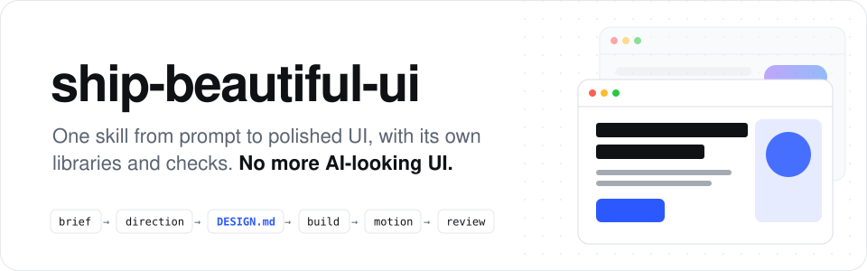

<p align="center">
  <picture>
    <source media="(prefers-color-scheme: dark)" srcset="../../assets/readme/header-dark.svg">
    
  </picture>
</p>

<p align="center">
  <b>Ein Skill, der deinen Coding-Agenten vom Prompt zur ausgefeilten UI bringt.<br>Eigene Design-Bibliotheken, eigene Prüfungen und Designs, die aus deinem Thema entstehen, nicht aus einer Vorlage.</b>
</p>

<p align="center">
  <a href="../../LICENSE"></a>
  <a href="../../skills/ship-beautiful-ui/SKILL.md"></a>
  
  
  <a href="https://github.com/Vedmeena21/ship-beautiful-ui/stargazers"></a>
  <a href="https://www.linkedin.com/in/ved-prakash-meena"></a>
</p>

<p align="center">
  <a href="#installation">Installation</a> ·
  <a href="#so-funktioniert-es">So funktioniert es</a> ·
  <a href="#deine-marke-deine-farben">Deine Marke, deine Farben</a> ·
  <a href="#was-drin-ist">Was drin ist</a> ·
  <a href="#der-detektor">Der Detektor</a>
</p>

| Typischer erster KI-Entwurf | Gebaut mit ship-beautiful-ui |
|:---:|:---:|
|  |  |

### 🌐 Mehrsprachige Unterstützung

[English](../../README.md) | [Arabic](../ar/README.md) | [Chinese (Simplified)](../zh/README.md) | [French](../fr/README.md) | [German](../de/README.md) | [Hindi](../hi/README.md) | [Indonesian](../id/README.md) | [Japanese](../ja/README.md) | [Korean](../ko/README.md) | [Portuguese (Brazil)](../pt-BR/README.md) | [Russian](../ru/README.md) | [Spanish](../es/README.md) | [Turkish](../tr/README.md)

---

## Warum es das gibt

Coding-Agenten schreiben ein ganzes Frontend in Minuten, und trotzdem sieht es aus wie jede andere KI-gebaute Seite: dieselbe Schrift, derselbe lila Verlauf, dieselbe Reihe aus drei identischen Karten, dasselbe Fade-up in jedem Abschnitt.

Das passiert, weil der Agent jedes Mal mit denselben Standardwerten startet. **ship-beautiful-ui** ersetzt diese Standards durch einen Prozess, echte Design-Daten und Prüfungen, die auf dem Ergebnis laufen:

- **Ein Prozess.** Brief → Richtung → Festlegen → Bauen → Bewegung → Review, immer in dieser Reihenfolge.
- **Design aus deinem Thema.** Die Palette kommt aus der eigenen Welt deines Produkts (Kruste und Mehl einer Bäckerei, das Rot der Dunkelkammerlampe), nicht aus einer Liste, die alle teilen.
- **Eine einzige Quelle der Wahrheit.** Jede visuelle Entscheidung wird vor dem ersten Code in `DESIGN.md` festgehalten und geprüft.
- **Prüfungen statt Bauchgefühl.** Ein Detektor mit 40 Regeln durchsucht den Code vor der Übergabe nach KI-Mustern und Barrierefreiheitslücken.

Keine Abhängigkeiten. Die Skripte sind reines Python 3.

## Installation

**Jeder Agent (Claude Code, Codex, Cursor und mehr)** über die [`skills`](https://github.com/vercel-labs/skills) CLI:

```bash
npx skills add Vedmeena21/ship-beautiful-ui
```

**Claude Code Plugin:**

```
/plugin marketplace add Vedmeena21/ship-beautiful-ui
/plugin install ship-beautiful-ui@ship-beautiful-ui
```

**Manuell:** kopiere [`skills/ship-beautiful-ui`](../../skills/ship-beautiful-ui) nach `.claude/skills/` (Projekt) oder `~/.claude/skills/` (global).

**Dann einfach nach UI fragen.** Der Skill startet von selbst, wenn du eine Seite, einen Screen oder eine Komponente baust, neu gestaltest oder verfeinerst:

```
Baue eine Landingpage für ein Rechnungstool für freiberufliche Fotografen.
Die eine Aufgabe: die erste Rechnung in unter 2 Minuten senden. Next.js + Tailwind.
```

```
Dieses Dashboard sieht generisch aus. Nutze ship-beautiful-ui, um es neu zu gestalten.
```

Du bekommst drei Dinge zurück:

| Ergebnis | Was es ist |
|---|---|
| `DESIGN.md` | Dein Design-System: Tokens und Regeln, die jeder Agent lesen kann, mit geprüftem Kontrast |
| Die UI | Nur aus den Tokens in `DESIGN.md` gebaut |
| `REVIEW.md` | Was der Detektor gefunden hat, was behoben wurde, was blieb und warum |

## So funktioniert es

<p align="center">
  
</p>

| Schritt | Was passiert | Eingebaut |
|---|---|---|
| **0. Brief** | Thema, Zielgruppe, die eine Aufgabe des Screens, fünf Begriffe aus der Welt des Themas | [`00-brief.md`](../../skills/ship-beautiful-ui/references/00-brief.md) |
| **1. Richtung** | Eine Palette, ein Schriftpaar und ein Layout für genau dieses Thema | `derive.py`, `direction.py`, 78 Materialien, 60 Paletten, 40 Schriftpaare, 20 Layouts |
| **2. Festlegen** | Jede Entscheidung in `DESIGN.md` festgehalten und geprüft | `lint_design.py`, [`DESIGN.md`-Vorlage](../../skills/ship-beautiful-ui/templates/DESIGN.md) |
| **3. Bauen** | Nur Tokens, eine mutige Idee, die Qualitätsuntergrenze | [`effects.md`](../../skills/ship-beautiful-ui/references/effects.md) (16 Effekte), [`ux-rules.md`](../../skills/ship-beautiful-ui/references/ux-rules.md) (80 Regeln) |
| **4. Bewegung** | Nur Bewegung, die eine Änderung erklärt | [`04-motion.md`](../../skills/ship-beautiful-ui/references/04-motion.md): Timing-Tokens und 12 Rezepte |
| **5. Review** | Eine Prüfung vor der Übergabe | `detect.py` (40 Regeln), Screenshots, [`REVIEW.md`](../../skills/ship-beautiful-ui/templates/REVIEW.md) |

**Wer gewinnt, wenn Anweisungen sich widersprechen:** deine Worte > `DESIGN.md` > die Regeln des Skills > alles andere Geladene. Der Agent sagt es offen, wenn er einen Konflikt auflöst, damit du widersprechen kannst.

## Deine Marke, deine Farben

Sag dem Agenten, was dein Produkt ist, und er gestaltet für dieses Produkt, nicht aus einer gemeinsamen Liste. Arbeitest du für ein Unternehmen mit Markenfarben? Er nutzt sie. Noch keine Marke? Er wählt passende Farben.

- **Du hast eine Marke.** Teile deine Farben, und sie bleiben genau so, wie sie sind. Der Agent ergänzt den Rest, den eine echte UI braucht: Text, Rahmen sowie Hover- und Fehlerfarben.
- **Du hast noch keine.** Beschreibe dein Produkt in ein paar Worten, und der Agent wählt Farben, die dazu passen.
- **Noch unsicher?** `direction.py` bietet drei fertige Looks zur Auswahl.

In jedem Fall wird jede Farbe auf gute Lesbarkeit geprüft (WCAG AA), bevor eine Zeile Code geschrieben wird.

## Was drin ist

Alles, was dein Agent braucht, um wie ein Profi zu gestalten, in einem Ordner. Keine Konten, keine API-Keys, nichts zusätzlich zu installieren.

| Was du bekommst | Wie viele | Warum es zählt |
|---|:---:|---|
| Materialien aus der echten Welt | **78** | Farben von Dingen wie Kraftpapier, Espresso, Moos und Film, damit die Palette zu deinem Produkt passt |
| Farbpaletten | **60** | Sofort nutzbar, hell und dunkel, jede auf Lesbarkeit getestet |
| Schriftpaare | **40** | Eine Überschrift- und eine Textschrift, die zusammenpassen, alle kostenlos bei Google Fonts |
| Seitenlayouts | **20** | Bewährte Seitenstrukturen mit Skizzen: Produkt-Hero, Editorial, Dashboard, Preise und mehr |
| Visuelle Effekte | **16** | Körnung, Glühen, Spotlight, Laufband, Neigung und mehr: CSS zum Kopieren, das deine Farben übernimmt und reduzierte Bewegung respektiert |
| Animationsrezepte | **12** | Buttons, Menüs, Dialoge, Toasts, Tabs und Listen, die sich alle gleich sauber bewegen |
| UX-Regeln | **80** | Eine Checkliste für Formulare, Navigation, Tabellen, Diagramme, Mobile sowie Leer- und Fehlerzustände |
| Detektor-Prüfungen | **40** | Finden den KI-Look und Barrierefreiheitslücken, bevor du veröffentlichst |

### Vier Tools, die die Arbeit erledigen

| Tool | Was es für dich tut |
|---|---|
| `derive.py` | Beschreibe dein Produkt in ein paar Worten und bekomme eine passende Farbpalette |
| `direction.py` | Unsicher, wo du anfangen sollst? Bekomme 3 Design-Richtungen zur Auswahl, gespeichert als `DESIGN.md` |
| `lint_design.py` | Prüft, ob deine `DESIGN.md` vollständig ist und jede Farbe lesbar ist |
| `detect.py` | Durchsucht deinen Code (HTML, CSS, React, Vue, Svelte, Astro) nach 40 Anzeichen für KI-gemachte UI |

## Der Detektor

```
$ python3 scripts/detect.py src/
SBU001 warning One generic sans for everything
SBU002 warning Purple-to-blue gradient
SBU010 error   Motion without reduced-motion support
SBU011 error   Focus outline removed
SBU013 warning Cream page + terracotta accent
...
Scanned 1 files: 6 errors, 10 warnings, 5 info
```

Jeder Fund kommt mit einer Lösung. Fehler blockieren die Übergabe; Warnungen werden behoben oder in `REVIEW.md` schriftlich begründet. Die vollständige Liste, plus 12 visuelle Standardmuster, die der Agent per Auge prüft, steht in [`anti-patterns.md`](../../skills/ship-beautiful-ui/references/anti-patterns.md).

## Lizenz

[MIT](../../LICENSE). Entwickelt und gepflegt von **Ved Prakash Meena**.

<a href="https://www.linkedin.com/in/ved-prakash-meena"></a>

<p align="center">
  <sub>Wenn dir das eine Runde „lass es weniger nach KI aussehen“ erspart hat, hilft ein ⭐ anderen, es zu finden, und <a href="https://www.linkedin.com/in/ved-prakash-meena">folge mir auf LinkedIn</a> für mehr.</sub>
</p>
