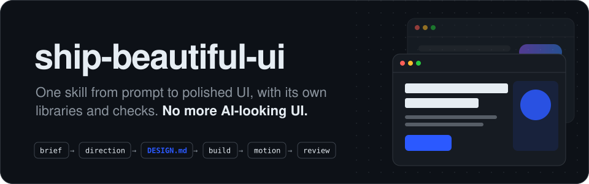

<p align="center">
  
</p>

<p align="center">
  <b>Una skill que lleva a tu agente de código del prompt a una UI pulida.<br>Sus propias librerías de diseño, sus propias comprobaciones y diseños que nacen de tu tema, no de una plantilla.</b>
</p>

```bash
npx skills add Vedmeena21/ship-beautiful-ui
```

<p align="center">
  <a href="../../LICENSE"></a>
  <a href="../../skills/ship-beautiful-ui/SKILL.md"></a>
  
  
  <a href="https://github.com/Vedmeena21/ship-beautiful-ui/stargazers"></a>
  <a href="../../translations"></a>
</p>

<p align="center">
  <a href="#instalación">Instalación</a> ·
  <a href="#cómo-funciona">Cómo funciona</a> ·
  <a href="#tu-marca-tus-colores">Tu marca, tus colores</a> ·
  <a href="#qué-incluye">Qué incluye</a>
</p>

| Primer borrador típico de IA | Hecho con ship-beautiful-ui |
|:---:|:---:|
|  |  |

<details>
<summary>🌐 Soporte multilingüe</summary>

[English](../../README.md) | [Arabic](../ar/README.md) | [Chinese (Simplified)](../zh/README.md) | [French](../fr/README.md) | [German](../de/README.md) | [Hindi](../hi/README.md) | [Indonesian](../id/README.md) | [Japanese](../ja/README.md) | [Korean](../ko/README.md) | [Portuguese (Brazil)](../pt-BR/README.md) | [Russian](../ru/README.md) | [Spanish](../es/README.md) | [Turkish](../tr/README.md)

</details>

---

## Por qué existe

Los agentes de código escriben un frontend entero en minutos, y aun así sale igual que cualquier otra página hecha con IA: la misma fuente, el mismo degradado morado, la misma fila de tres tarjetas idénticas, el mismo fade-up en cada sección.

Pasa porque el agente parte siempre de los mismos valores por defecto. **ship-beautiful-ui** los reemplaza con un proceso, datos de diseño reales y comprobaciones que se ejecutan sobre el resultado:

- **Un proceso.** Brief → dirección → fijar → construir → movimiento → revisión, siempre en ese orden.
- **Diseño desde tu tema.** La paleta sale de cosas del propio mundo de tu producto (la corteza y la harina de una panadería, el rojo de la luz de seguridad de un cuarto oscuro), no de una lista que todos comparten.
- **Una única fuente de verdad.** Cada decisión visual se escribe en `DESIGN.md` antes de cualquier código, y se comprueba.
- **Comprobaciones, no intuiciones.** Un detector de 40 reglas revisa el código en busca de señales de IA y fallos de accesibilidad antes de la entrega.

Sin dependencias. Los scripts son Python 3 puro.

## Instalación

**Cualquier agente (Claude Code, Codex, Cursor y más)** con la CLI [`skills`](https://github.com/vercel-labs/skills):

```bash
npx skills add Vedmeena21/ship-beautiful-ui
```

**Plugin de Claude Code:**

```
/plugin marketplace add Vedmeena21/ship-beautiful-ui
/plugin install ship-beautiful-ui@ship-beautiful-ui
```

**Manual:** copia [`skills/ship-beautiful-ui`](../../skills/ship-beautiful-ui) en `.claude/skills/` (proyecto) o `~/.claude/skills/` (global).

**Después, solo pide UI.** La skill se activa sola cuando construyes, rediseñas o pules una página, pantalla o componente:

```
Crea una landing page para una herramienta de facturación para fotógrafos freelance.
El único objetivo: enviar la primera factura en menos de 2 minutos. Next.js + Tailwind.
```

```
Este dashboard se ve genérico. Usa ship-beautiful-ui para rediseñarlo.
```

Recibes tres cosas:

| Resultado | Qué es |
|---|---|
| `DESIGN.md` | Tu sistema de diseño: tokens y reglas que cualquier agente puede leer, con el contraste comprobado |
| La UI | Construida solo con los tokens de `DESIGN.md` |
| `REVIEW.md` | Qué encontró el detector, qué se corrigió, qué se mantuvo y por qué |

## Cómo funciona

<p align="center">
  
</p>

| Paso | Qué ocurre | Incluido |
|---|---|---|
| **0. Brief** | Tema, público, el único objetivo de la pantalla, cinco sustantivos del mundo del tema | [`00-brief.md`](../../skills/ship-beautiful-ui/references/00-brief.md) |
| **1. Dirección** | Una paleta, una combinación tipográfica y un layout hechos para este tema | `derive.py`, `direction.py`, 78 materiales, 60 paletas, 40 combinaciones, 20 layouts |
| **2. Fijar** | Cada decisión escrita en `DESIGN.md` y comprobada | `lint_design.py`, [plantilla de `DESIGN.md`](../../skills/ship-beautiful-ui/templates/DESIGN.md) |
| **3. Construir** | Solo tokens, una idea audaz, el estándar mínimo de calidad | [`effects.md`](../../skills/ship-beautiful-ui/references/effects.md) (16 efectos), [`ux-rules.md`](../../skills/ship-beautiful-ui/references/ux-rules.md) (80 reglas) |
| **4. Movimiento** | Solo el movimiento que explica un cambio | [`04-motion.md`](../../skills/ship-beautiful-ui/references/04-motion.md): tokens de tiempo y 12 recetas |
| **5. Revisión** | Un único control antes de la entrega | `detect.py` (40 reglas), capturas de pantalla, [`REVIEW.md`](../../skills/ship-beautiful-ui/templates/REVIEW.md) |

**Quién manda cuando las instrucciones chocan:** tus palabras > `DESIGN.md` > las reglas de la skill > cualquier otra cosa cargada. El agente lo dice en voz alta cuando resuelve un conflicto, para que puedas corregirlo.

## Tu marca, tus colores

Dile al agente qué es tu producto y diseñará para ese producto, no desde una lista compartida. ¿Trabajas en una empresa con colores de marca? Los usa. ¿Aún no tienes marca? Elige colores que encajen.

- **Tienes una marca.** Comparte tus colores y se mantienen tal cual. El agente añade el resto que necesita una UI real: texto, bordes y colores de hover y de error.
- **Aún no tienes una.** Describe tu producto en pocas palabras y el agente elige colores que encajen con lo que hace.
- **¿Todavía no lo tienes claro?** `direction.py` ofrece tres estilos ya preparados para elegir.

En cualquier caso, se comprueba que cada color sea fácil de leer (WCAG AA) antes de escribir una sola línea de código.

## Qué incluye

Todo lo que tu agente necesita para diseñar como un profesional, en una carpeta. Sin cuentas, sin API keys, sin nada extra que instalar.

| Qué recibes | Cuántos | Por qué importa |
|---|:---:|---|
| Materiales del mundo real | **78** | Colores sacados de cosas como papel kraft, espresso, musgo y película, para que la paleta encaje con tu producto |
| Paletas de color | **60** | Listas para usar, claras y oscuras, todas probadas para que se lean bien |
| Combinaciones de fuentes | **40** | Una fuente para títulos y otra para texto que funcionan juntas, todas gratis en Google Fonts |
| Layouts de página | **20** | Estructuras probadas con bocetos: hero de producto, editorial, dashboard, precios y más |
| Efectos visuales | **16** | Grano, brillo, foco, marquesina, inclinación y más: CSS para copiar y pegar que toma tus colores y respeta el movimiento reducido |
| Recetas de animación | **12** | Botones, menús, modales, avisos, pestañas y listas que se mueven igual de pulidos |
| Reglas de UX | **80** | Una checklist para formularios, navegación, tablas, gráficos, móvil y estados vacíos y de error |
| Comprobaciones del detector | **40** | Detectan el aspecto de IA y los fallos de accesibilidad antes de publicar |

## Licencia

[MIT](../../LICENSE). Creado y mantenido por **Ved Prakash Meena**.

<a href="https://www.linkedin.com/in/ved-prakash-meena"></a>

<p align="center">
  <sub>Si esto te ahorró una ronda de "haz que parezca menos IA", una ⭐ ayuda a que otros lo encuentren, y <a href="https://www.linkedin.com/in/ved-prakash-meena">sígueme en LinkedIn</a> para más.</sub>
</p>
