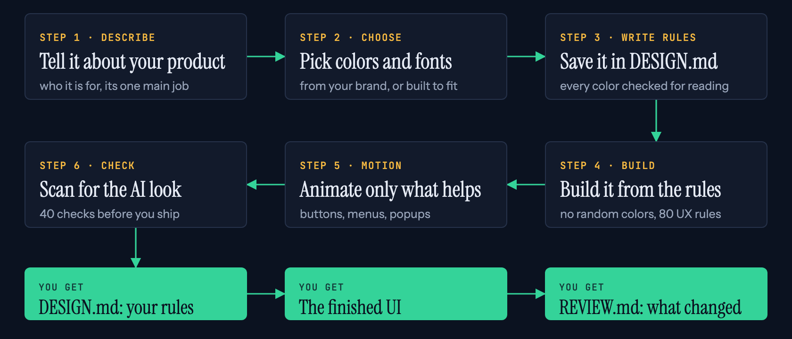

<p align="center">
  
</p>

<p align="center">
  <b>Une skill qui mène votre agent de code du prompt à une UI soignée.<br>Ses propres bibliothèques de design, ses propres vérifications, et des designs qui naissent de votre sujet, pas d'un modèle.</b>
</p>

```bash
npx skills add Vedmeena21/ship-beautiful-ui
```

<p align="center">
  <a href="../../LICENSE"></a>
  <a href="../../skills/ship-beautiful-ui/SKILL.md"></a>
  
  
  <a href="https://github.com/Vedmeena21/ship-beautiful-ui/stargazers"></a>
  <a href="../../translations"></a>
</p>

<p align="center">
  <a href="#installation">Installation</a> ·
  <a href="#comment-ça-marche">Comment ça marche</a> ·
  <a href="#votre-marque-vos-couleurs">Votre marque, vos couleurs</a> ·
  <a href="#ce-quil-contient">Ce qu'il contient</a>
</p>

| Premier jet typique d'une IA | Fait avec ship-beautiful-ui |
|:---:|:---:|
|  |  |

<details>
<summary>🌐 Support multilingue</summary>

[English](../../README.md) | [Arabic](../ar/README.md) | [Chinese (Simplified)](../zh/README.md) | [French](../fr/README.md) | [German](../de/README.md) | [Hindi](../hi/README.md) | [Indonesian](../id/README.md) | [Japanese](../ja/README.md) | [Korean](../ko/README.md) | [Portuguese (Brazil)](../pt-BR/README.md) | [Russian](../ru/README.md) | [Spanish](../es/README.md) | [Turkish](../tr/README.md)

</details>

---

## Pourquoi ce projet

Les agents de code écrivent un frontend entier en quelques minutes, et le résultat ressemble pourtant à toutes les autres pages faites par IA : la même police, le même dégradé violet, la même rangée de trois cartes identiques, le même fondu vers le haut sur chaque section.

C'est parce que l'agent part toujours des mêmes réglages par défaut. **ship-beautiful-ui** les remplace par un processus, de vraies données de design et des vérifications qui tournent sur le résultat :

- **Un processus.** Brief → direction → verrouillage → construction → animation → revue, toujours dans cet ordre.
- **Un design tiré de votre sujet.** La palette vient du monde de votre produit (la croûte et la farine d'une boulangerie, le rouge inactinique d'une chambre noire), pas d'une liste que tout le monde partage.
- **Une seule source de vérité.** Chaque décision visuelle est écrite dans `DESIGN.md` avant tout code, puis vérifiée.
- **Des vérifications, pas des impressions.** Un détecteur de 40 règles analyse le code à la recherche de signes d'IA et de lacunes d'accessibilité avant la livraison.

Aucune dépendance. Les scripts sont en Python 3 standard.

## Installation

**N'importe quel agent (Claude Code, Codex, Cursor et plus)** via la CLI [`skills`](https://github.com/vercel-labs/skills) :

```bash
npx skills add Vedmeena21/ship-beautiful-ui
```

**Plugin Claude Code :**

```
/plugin marketplace add Vedmeena21/ship-beautiful-ui
/plugin install ship-beautiful-ui@ship-beautiful-ui
```

**Manuellement :** copiez [`skills/ship-beautiful-ui`](../../skills/ship-beautiful-ui) dans `.claude/skills/` (projet) ou `~/.claude/skills/` (global).

**Ensuite, demandez simplement une UI.** La skill se lance d'elle-même quand vous créez, refaites ou peaufinez une page, un écran ou un composant :

```
Crée une landing page pour un outil de facturation destiné aux photographes freelances.
Le seul objectif : envoyer une première facture en moins de 2 minutes. Next.js + Tailwind.
```

```
Ce dashboard a l'air générique. Utilise ship-beautiful-ui pour le refaire.
```

Vous obtenez trois choses :

| Livrable | Ce que c'est |
|---|---|
| `DESIGN.md` | Votre design system : tokens et règles lisibles par n'importe quel agent, contraste vérifié |
| L'UI | Construite uniquement avec les tokens de `DESIGN.md` |
| `REVIEW.md` | Ce que le détecteur a trouvé, ce qui a été corrigé, ce qui a été gardé et pourquoi |

## Comment ça marche

<p align="center">
  
</p>

| Étape | Ce qui se passe | Inclus |
|---|---|---|
| **0. Brief** | Sujet, public, l'unique objectif de l'écran, cinq noms tirés du monde du sujet | [`00-brief.md`](../../skills/ship-beautiful-ui/references/00-brief.md) |
| **1. Direction** | Une palette, un duo typographique et une mise en page faits pour ce sujet | `derive.py`, `direction.py`, 78 matériaux, 60 palettes, 40 duos, 20 mises en page |
| **2. Verrouillage** | Chaque décision écrite dans `DESIGN.md` et vérifiée | `lint_design.py`, [modèle `DESIGN.md`](../../skills/ship-beautiful-ui/templates/DESIGN.md) |
| **3. Construction** | Uniquement des tokens, une idée forte, le niveau de qualité minimum | [`effects.md`](../../skills/ship-beautiful-ui/references/effects.md) (16 effets), [`ux-rules.md`](../../skills/ship-beautiful-ui/references/ux-rules.md) (80 règles) |
| **4. Animation** | Seulement les animations qui expliquent un changement | [`04-motion.md`](../../skills/ship-beautiful-ui/references/04-motion.md): tokens de timing et 12 recettes |
| **5. Revue** | Un seul contrôle avant la livraison | `detect.py` (40 règles), captures d'écran, [`REVIEW.md`](../../skills/ship-beautiful-ui/templates/REVIEW.md) |

**Qui l'emporte quand les consignes se contredisent :** vos mots > `DESIGN.md` > les règles de la skill > tout le reste. L'agent le dit clairement quand il tranche un conflit, pour que vous puissiez le contredire.

## Votre marque, vos couleurs

Dites à l'agent ce qu'est votre produit, et il conçoit pour ce produit, pas à partir d'une liste commune. Vous travaillez pour une entreprise avec des couleurs de marque ? Il les utilise. Pas encore de marque ? Il choisit des couleurs adaptées.

- **Vous avez une marque.** Partagez vos couleurs, elles sont conservées telles quelles. L'agent ajoute le reste dont une vraie UI a besoin : texte, bordures, couleurs de survol et d'erreur.
- **Vous n'en avez pas encore.** Décrivez votre produit en quelques mots et l'agent choisit des couleurs qui correspondent à ce qu'il fait.
- **Pas encore sûr ?** `direction.py` propose trois styles prêts à l'emploi parmi lesquels choisir.

Dans tous les cas, chaque couleur est vérifiée pour être facile à lire (WCAG AA) avant d'écrire une seule ligne de code.

## Ce qu'il contient

Tout ce dont votre agent a besoin pour designer comme un pro, dans un seul dossier. Pas de compte, pas de clé API, rien d'autre à installer.

| Ce que vous obtenez | Combien | Pourquoi c'est utile |
|---|:---:|---|
| Matériaux du monde réel | **78** | Des couleurs tirées de choses comme le papier kraft, l'espresso, la mousse et la pellicule, pour une palette qui colle à votre produit |
| Palettes de couleurs | **60** | Prêtes à l'emploi, claires et sombres, toutes testées pour la lisibilité |
| Duos de polices | **40** | Une police de titre et une police de texte qui vont ensemble, toutes gratuites sur Google Fonts |
| Mises en page | **20** | Des structures éprouvées avec croquis : hero produit, éditorial, dashboard, tarifs et plus |
| Effets visuels | **16** | Grain, halo, projecteur, défilement, inclinaison et plus : du CSS à copier-coller qui reprend vos couleurs et respecte le mouvement réduit |
| Recettes d'animation | **12** | Boutons, menus, modales, notifications, onglets et listes qui bougent tous avec la même finition |
| Règles UX | **80** | Une checklist pour les formulaires, la navigation, les tableaux, les graphiques, le mobile et les états vides ou d'erreur |
| Contrôles du détecteur | **40** | Repèrent le look IA et les lacunes d'accessibilité avant la mise en ligne |

## Licence

[MIT](../../LICENSE). Créé et maintenu par **Ved Prakash Meena**.

<a href="https://www.linkedin.com/in/ved-prakash-meena"></a>

<p align="center">
  <sub>Si cela vous a évité un tour de « rends ça moins IA », une ⭐ aide les autres à le trouver, et <a href="https://www.linkedin.com/in/ved-prakash-meena">suivez-moi sur LinkedIn</a> pour plus.</sub>
</p>
