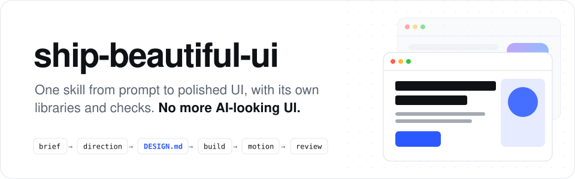

<p align="center">
  <picture>
    <source media="(prefers-color-scheme: dark)" srcset="../../assets/readme/header-dark.svg">
    
  </picture>
</p>

<p align="center">
  <b>एक skill जो आपके coding agent को prompt से polished UI तक ले जाता है।<br>अपनी design libraries, अपने checks, और ऐसे designs जो template से नहीं, आपके subject से बनते हैं।</b>
</p>

<p align="center">
  <a href="../../LICENSE"></a>
  <a href="../../skills/ship-beautiful-ui/SKILL.md"></a>
  
  
  <a href="https://github.com/Vedmeena21/ship-beautiful-ui/stargazers"></a>
  <a href="https://www.linkedin.com/in/ved-prakash-meena"></a>
</p>

<p align="center">
  <a href="#इंस्टॉल-करें">इंस्टॉल करें</a> ·
  <a href="#यह-कैसे-काम-करता-है">यह कैसे काम करता है</a> ·
  <a href="#आपका-brand-आपके-रंग">आपका brand, आपके रंग</a> ·
  <a href="#इसमें-क्या-है">इसमें क्या है</a>
</p>

| आम AI पहला draft | ship-beautiful-ui से बना |
|:---:|:---:|
|  |  |

### 🌐 कई भाषाओं में उपलब्ध

[English](../../README.md) | [Arabic](../ar/README.md) | [Chinese (Simplified)](../zh/README.md) | [French](../fr/README.md) | [German](../de/README.md) | [Hindi](../hi/README.md) | [Indonesian](../id/README.md) | [Japanese](../ja/README.md) | [Korean](../ko/README.md) | [Portuguese (Brazil)](../pt-BR/README.md) | [Russian](../ru/README.md) | [Spanish](../es/README.md) | [Turkish](../tr/README.md)

---

## यह क्यों बना

Coding agents कुछ ही मिनटों में पूरा frontend लिख देते हैं, फिर भी वह हर दूसरे AI पेज जैसा दिखता है: वही font, वही बैंगनी gradient, वही तीन एक जैसे cards की कतार, हर section पर वही fade-up।

ऐसा इसलिए होता है क्योंकि agent हर बार उन्हीं defaults से शुरू करता है। **ship-beautiful-ui** इन defaults की जगह एक process, असली design data, और नतीजे पर चलने वाले checks लाता है:

- **एक process।** Brief → direction → lock → build → motion → review, हमेशा इसी क्रम में।
- **आपके subject से design।** Palette आपके product की अपनी दुनिया से आता है (bakery की crust और आटा, darkroom की safelight का लाल), सबकी साझा list से नहीं।
- **सच का एक ही स्रोत।** हर visual फ़ैसला code से पहले `DESIGN.md` में लिखा और check किया जाता है।
- **अंदाज़ा नहीं, checks।** Handoff से पहले 40 rules वाला detector code में AI वाले निशान और accessibility की कमियाँ ढूँढता है।

कोई dependency नहीं। Scripts सादे Python 3 में हैं।

## इंस्टॉल करें

**कोई भी agent (Claude Code, Codex, Cursor और भी)** [`skills`](https://github.com/vercel-labs/skills) CLI से:

```bash
npx skills add Vedmeena21/ship-beautiful-ui
```

**Claude Code plugin:**

```
/plugin marketplace add Vedmeena21/ship-beautiful-ui
/plugin install ship-beautiful-ui@ship-beautiful-ui
```

**Manual:** [`skills/ship-beautiful-ui`](../../skills/ship-beautiful-ui) को `.claude/skills/` (project) या `~/.claude/skills/` (global) में copy करें।

**फिर बस UI माँगिए।** जब आप कोई page, screen या component बनाते, redesign करते या polish करते हैं, skill अपने आप शुरू हो जाता है:

```
Freelance photographers के लिए invoicing tool का landing page बनाओ।
एक ही काम: 2 मिनट से कम में पहला invoice भेजना। Next.js + Tailwind.
```

```
यह dashboard बहुत generic दिखता है। ship-beautiful-ui से इसे redesign करो।
```

आपको तीन चीज़ें मिलती हैं:

| Output | क्या है |
|---|---|
| `DESIGN.md` | आपका design system: tokens और rules जो कोई भी agent पढ़ सके, contrast check के साथ |
| UI | सिर्फ़ `DESIGN.md` के tokens से बना |
| `REVIEW.md` | Detector ने क्या पाया, क्या ठीक हुआ, क्या रखा गया और क्यों |

## यह कैसे काम करता है

<p align="center">
  
</p>

| Step | क्या होता है | Built in |
|---|---|---|
| **0. Brief** | Subject, audience, screen का एक ही काम, subject की दुनिया से पाँच संज्ञाएँ | [`00-brief.md`](../../skills/ship-beautiful-ui/references/00-brief.md) |
| **1. Direction** | इसी subject के लिए बना palette, font pairing और layout | `derive.py`, `direction.py`, 78 materials, 60 palettes, 40 pairings, 20 layouts |
| **2. Lock** | हर फ़ैसला `DESIGN.md` में लिखा और check किया गया | `lint_design.py`, [`DESIGN.md` template](../../skills/ship-beautiful-ui/templates/DESIGN.md) |
| **3. Build** | सिर्फ़ tokens, एक bold idea, quality की न्यूनतम रेखा | [`effects.md`](../../skills/ship-beautiful-ui/references/effects.md) (16 effects), [`ux-rules.md`](../../skills/ship-beautiful-ui/references/ux-rules.md) (80 rules) |
| **4. Motion** | सिर्फ़ वही motion जो किसी बदलाव को समझाए | [`04-motion.md`](../../skills/ship-beautiful-ui/references/04-motion.md): timing tokens और 12 recipes |
| **5. Review** | Handoff से पहले एक gate | `detect.py` (40 rules), screenshots, [`REVIEW.md`](../../skills/ship-beautiful-ui/templates/REVIEW.md) |

**जब निर्देश टकराएँ तो किसकी चलेगी:** आपकी बात > `DESIGN.md` > skill के rules > बाकी कुछ भी। Conflict सुलझाते समय agent साफ़ बताता है, ताकि आप उसे बदल सकें।

## आपका brand, आपके रंग

Agent को बताइए कि आपका product क्या है, और वह उसी product के लिए design करता है, किसी साझा list से नहीं। कंपनी के brand colors हैं? वह उन्हें इस्तेमाल करता है। अभी brand नहीं है? वह ऐसे रंग चुनता है जो मेल खाएँ।

- **आपके पास brand है।** अपने रंग दीजिए, वे जैसे हैं वैसे ही रखे जाते हैं। बाकी जो असली UI को चाहिए, agent जोड़ देता है: text, borders, hover और error के रंग।
- **अभी brand नहीं है।** अपने product को कुछ शब्दों में बताइए, और agent ऐसे रंग चुनता है जो उसके विषय से मेल खाते हों।
- **अभी पक्का नहीं है?** `direction.py` चुनने के लिए तीन तैयार looks देता है।

दोनों ही तरह, code की एक line लिखने से पहले हर रंग की readability (WCAG AA) check होती है।

## इसमें क्या है

आपके agent को pro की तरह design करने के लिए जो चाहिए, सब एक folder में। कोई account नहीं, कोई API key नहीं, कुछ और install नहीं करना।

| आपको क्या मिलता है | कितने | क्यों काम का है |
|---|:---:|---|
| असली दुनिया के materials | **78** | Kraft paper, espresso, moss और film जैसी चीज़ों से लिए रंग, ताकि palette आपके product से मेल खाए |
| Color palettes | **60** | इस्तेमाल के लिए तैयार, light और dark, हर एक readability के लिए tested |
| Font pairings | **40** | Heading और body के लिए साथ में जमने वाले fonts, सब Google Fonts पर free |
| Page layouts | **20** | Sketches के साथ आज़माए हुए page structures: product hero, editorial, dashboard, pricing और भी |
| Visual effects | **16** | Grain, glow, spotlight, marquee, tilt और भी: copy-paste CSS जो आपके रंग लेता है और reduced motion का ध्यान रखता है |
| Animation recipes | **12** | Buttons, menus, modals, toasts, tabs और lists जो सब एक ही polished तरीके से चलते हैं |
| UX rules | **80** | Forms, navigation, tables, charts, mobile, और empty व error states के लिए checklist |
| Detector checks | **40** | Ship करने से पहले AI वाला look और accessibility की कमियाँ पकड़ते हैं |

## License

[MIT](../../LICENSE). **Ved Prakash Meena** द्वारा बनाया और maintain किया गया।

<a href="https://www.linkedin.com/in/ved-prakash-meena"></a>

<p align="center">
  <sub>अगर इसने आपको "इसे कम AI जैसा बनाओ" वाला एक round बचाया, तो एक ⭐ दूसरों को इसे ढूँढने में मदद करता है, और ऐसी और चीज़ों के लिए <a href="https://www.linkedin.com/in/ved-prakash-meena">LinkedIn पर follow करें</a>।</sub>
</p>
