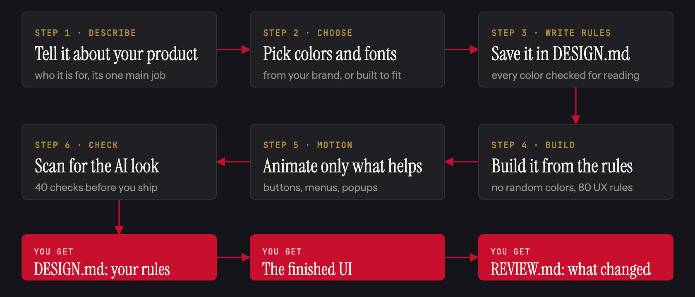

<p align="center">
  
</p>

<p align="center">
  <b>Satu skill yang membawa agen coding Anda dari prompt ke UI yang rapi.<br>Pustaka desain sendiri, pemeriksaan sendiri, dan desain yang lahir dari topik Anda, bukan dari template.</b>
</p>

```bash
npx skills add Vedmeena21/ship-beautiful-ui
```

<p align="center">
  <a href="../../LICENSE"></a>
  <a href="../../skills/ship-beautiful-ui/SKILL.md"></a>
  
  
  <a href="https://github.com/Vedmeena21/ship-beautiful-ui/stargazers"></a>
  <a href="../../translations"></a>
</p>

<p align="center">
  <a href="#instalasi">Instalasi</a> ·
  <a href="#cara-kerjanya">Cara kerjanya</a> ·
  <a href="#brand-anda-warna-anda">Brand Anda, warna Anda</a> ·
  <a href="#isinya">Isinya</a>
</p>

| Draf pertama AI yang umum | Dibuat dengan ship-beautiful-ui |
|:---:|:---:|
|  |  |

<details>
<summary>🌐 Dukungan multibahasa</summary>

[English](../../README.md) | [Arabic](../ar/README.md) | [Chinese (Simplified)](../zh/README.md) | [French](../fr/README.md) | [German](../de/README.md) | [Hindi](../hi/README.md) | [Indonesian](../id/README.md) | [Japanese](../ja/README.md) | [Korean](../ko/README.md) | [Portuguese (Brazil)](../pt-BR/README.md) | [Russian](../ru/README.md) | [Spanish](../es/README.md) | [Turkish](../tr/README.md)

</details>

---

## Mengapa ini ada

Agen coding bisa menulis seluruh frontend dalam hitungan menit, tetapi hasilnya tetap terlihat seperti halaman buatan AI lainnya: font yang sama, gradasi ungu yang sama, deretan tiga kartu identik yang sama, animasi fade-up yang sama di setiap bagian.

Hal itu terjadi karena agen selalu memulai dari pengaturan bawaan yang sama. **ship-beautiful-ui** menggantinya dengan proses, data desain yang nyata, dan pemeriksaan yang dijalankan pada hasilnya:

- **Sebuah proses.** Brief → arah → kunci → bangun → gerak → tinjauan, selalu dalam urutan ini.
- **Desain dari topik Anda.** Palet warna berasal dari dunia produk Anda sendiri (kerak dan tepung toko roti, merah lampu pengaman kamar gelap), bukan dari daftar yang dipakai semua orang.
- **Satu sumber kebenaran.** Setiap keputusan visual ditulis di `DESIGN.md` sebelum ada kode, lalu diperiksa.
- **Pemeriksaan, bukan firasat.** Detektor dengan 40 aturan memindai kode untuk mencari tanda-tanda AI dan celah aksesibilitas sebelum diserahkan.

Tanpa dependensi. Skripnya Python 3 biasa.

## Instalasi

**Agen apa pun (Claude Code, Codex, Cursor, dan lainnya)** lewat CLI [`skills`](https://github.com/vercel-labs/skills):

```bash
npx skills add Vedmeena21/ship-beautiful-ui
```

**Plugin Claude Code:**

```
/plugin marketplace add Vedmeena21/ship-beautiful-ui
/plugin install ship-beautiful-ui@ship-beautiful-ui
```

**Manual:** salin [`skills/ship-beautiful-ui`](../../skills/ship-beautiful-ui) ke `.claude/skills/` (proyek) atau `~/.claude/skills/` (global).

**Lalu tinggal minta UI.** Skill berjalan sendiri saat Anda membuat, mendesain ulang, atau memoles halaman, layar, atau komponen:

```
Buatkan landing page untuk alat penagihan bagi fotografer freelance.
Tujuan utamanya: mengirim invoice pertama dalam waktu kurang dari 2 menit. Next.js + Tailwind.
```

```
Dashboard ini terlihat biasa saja. Pakai ship-beautiful-ui untuk mendesain ulangnya.
```

Anda mendapat tiga hal:

| Hasil | Apa itu |
|---|---|
| `DESIGN.md` | Sistem desain Anda: token dan aturan yang bisa dibaca agen mana pun, kontrasnya sudah diperiksa |
| UI | Dibangun hanya dari token `DESIGN.md` |
| `REVIEW.md` | Apa yang ditemukan detektor, apa yang diperbaiki, apa yang dipertahankan dan alasannya |

## Cara kerjanya

<p align="center">
  
</p>

| Langkah | Apa yang terjadi | Sudah termasuk |
|---|---|---|
| **0. Brief** | Topik, audiens, satu tugas utama layar, lima kata benda dari dunia topik | [`00-brief.md`](../../skills/ship-beautiful-ui/references/00-brief.md) |
| **1. Arah** | Palet warna, pasangan font, dan layout yang dibuat untuk topik ini | `derive.py`, `direction.py`, 78 material, 60 palet, 40 pasangan font, 20 layout |
| **2. Kunci** | Setiap keputusan ditulis di `DESIGN.md` dan diperiksa | `lint_design.py`, [template `DESIGN.md`](../../skills/ship-beautiful-ui/templates/DESIGN.md) |
| **3. Bangun** | Hanya token, satu ide berani, standar kualitas minimum | [`effects.md`](../../skills/ship-beautiful-ui/references/effects.md) (16 efek), [`ux-rules.md`](../../skills/ship-beautiful-ui/references/ux-rules.md) (80 aturan) |
| **4. Gerak** | Hanya gerakan yang menjelaskan sebuah perubahan | [`04-motion.md`](../../skills/ship-beautiful-ui/references/04-motion.md): token waktu dan 12 resep |
| **5. Tinjauan** | Satu gerbang sebelum diserahkan | `detect.py` (40 aturan), tangkapan layar, [`REVIEW.md`](../../skills/ship-beautiful-ui/templates/REVIEW.md) |

**Siapa yang menang saat instruksi bertentangan:** kata-kata Anda > `DESIGN.md` > aturan skill > semua yang dimuat lainnya. Agen menyebutkannya dengan jelas saat menyelesaikan konflik, sehingga Anda bisa menolaknya.

## Brand Anda, warna Anda

Beri tahu agen apa produk Anda, lalu ia mendesain untuk produk itu, bukan dari daftar yang dipakai semua orang. Bekerja di perusahaan dengan warna brand? Warna itu yang dipakai. Belum punya brand? Ia memilih warna yang cocok.

- **Anda punya brand.** Bagikan warna Anda dan warna itu dipertahankan persis seperti aslinya. Agen menambahkan sisanya yang dibutuhkan UI sungguhan: warna teks, garis tepi, hover, dan error.
- **Belum punya.** Jelaskan produk Anda dalam beberapa kata dan agen memilih warna yang cocok dengan topiknya.
- **Belum yakin?** `direction.py` menawarkan tiga tampilan siap pakai untuk dipilih.

Apa pun pilihannya, setiap warna dicek agar mudah dibaca (WCAG AA) sebelum satu baris kode pun ditulis.

## Isinya

Semua yang dibutuhkan agen Anda untuk mendesain seperti profesional, dalam satu folder. Tanpa akun, tanpa API key, tanpa instalasi tambahan.

| Yang Anda dapat | Berapa banyak | Mengapa penting |
|---|:---:|---|
| Material dunia nyata | **78** | Warna diambil dari hal-hal seperti kertas kraft, espresso, lumut, dan film, agar palet cocok dengan produk Anda |
| Palet warna | **60** | Siap dipakai, terang dan gelap, masing-masing sudah diuji keterbacaannya |
| Pasangan font | **40** | Font judul dan font isi yang serasi, semuanya gratis di Google Fonts |
| Layout halaman | **20** | Struktur halaman yang teruji beserta sketsa: hero produk, editorial, dashboard, harga, dan lainnya |
| Efek visual | **16** | Grain, glow, spotlight, marquee, tilt, dan lainnya: CSS siap salin yang memakai warna Anda dan menghormati pengaturan gerak berkurang |
| Resep animasi | **12** | Tombol, menu, modal, toast, tab, dan daftar yang semuanya bergerak dengan sama halusnya |
| Aturan UX | **80** | Daftar periksa untuk formulir, navigasi, tabel, grafik, mobile, serta kondisi kosong dan error |
| Pemeriksaan detektor | **40** | Menangkap tampilan khas AI dan celah aksesibilitas sebelum Anda rilis |

## Lisensi

[MIT](../../LICENSE). Dibuat dan dikelola oleh **Ved Prakash Meena**.

<a href="https://www.linkedin.com/in/ved-prakash-meena"></a>

<p align="center">
  <sub>Kalau ini menghemat satu putaran "buat supaya tidak terlalu seperti AI", sebuah ⭐ membantu orang lain menemukannya, dan <a href="https://www.linkedin.com/in/ved-prakash-meena">ikuti saya di LinkedIn</a> untuk lainnya.</sub>
</p>
