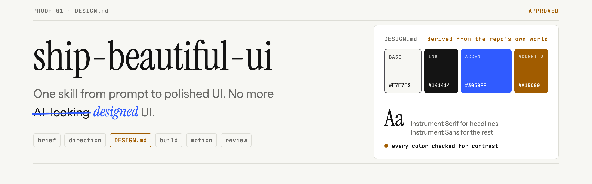
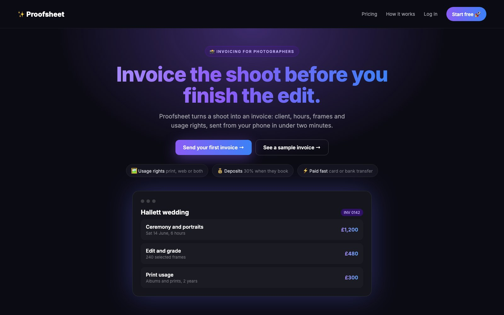
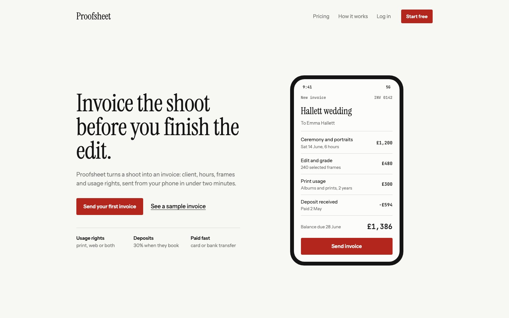
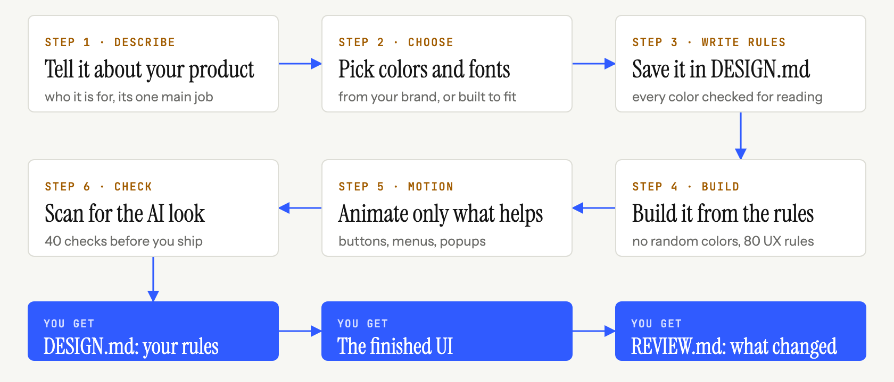

<p align="center">
  
</p>

<p align="center">
  <b>コーディングエージェントを、プロンプトから洗練された UI まで導く 1 つの skill。<br>独自のデザインライブラリ、独自のチェック、そしてテンプレートではなくあなたのテーマから生まれるデザイン。</b>
</p>

```bash
npx skills add Vedmeena21/ship-beautiful-ui
```

<p align="center">
  <a href="../../LICENSE"></a>
  <a href="../../skills/ship-beautiful-ui/SKILL.md"></a>
  
  
  <a href="https://github.com/Vedmeena21/ship-beautiful-ui/stargazers"></a>
  <a href="../../translations"></a>
</p>

<p align="center">
  <a href="#インストール">インストール</a> ·
  <a href="#仕組み">仕組み</a> ·
  <a href="#あなたのブランドあなたの色">あなたのブランド、あなたの色</a> ·
  <a href="#中身">中身</a>
</p>

| よくある AI の初稿 | ship-beautiful-ui で作成 |
|:---:|:---:|
|  |  |

<details>
<summary>🌐 多言語サポート</summary>

[English](../../README.md) | [Arabic](../ar/README.md) | [Chinese (Simplified)](../zh/README.md) | [French](../fr/README.md) | [German](../de/README.md) | [Hindi](../hi/README.md) | [Indonesian](../id/README.md) | [Japanese](../ja/README.md) | [Korean](../ko/README.md) | [Portuguese (Brazil)](../pt-BR/README.md) | [Russian](../ru/README.md) | [Spanish](../es/README.md) | [Turkish](../tr/README.md)

</details>

---

## なぜ作ったのか

コーディングエージェントはフロントエンド全体を数分で書けます。それでも仕上がりは他の AI 製ページとそっくりです。同じフォント、同じ紫のグラデーション、同じ 3 枚並びのカード、すべてのセクションに同じフェードアップ。

エージェントが毎回同じデフォルトから始めるからです。**ship-beautiful-ui** はそのデフォルトを、プロセス、本物のデザインデータ、そして結果に対して実行されるチェックに置き換えます：

- **プロセス。** ブリーフ → 方向性 → 固定 → 構築 → モーション → レビュー、常にこの順番で。
- **テーマからデザインする。** 配色は、みんなが使う共通リストではなく、あなたのプロダクト自身の世界（パン屋の焼き色と小麦粉、暗室のセーフライトの赤）から生まれます。
- **唯一の情報源。** すべての視覚的な決定は、コードを書く前に `DESIGN.md` に書かれ、チェックされます。
- **感覚ではなくチェック。** 40 ルールの検出器が、納品前にコードの AI っぽさとアクセシビリティの不備をスキャンします。

依存関係なし。スクリプトは素の Python 3 です。

## インストール

**あらゆるエージェント（Claude Code、Codex、Cursor など）** [`skills`](https://github.com/vercel-labs/skills) CLI で：

```bash
npx skills add Vedmeena21/ship-beautiful-ui
```

**Claude Code プラグイン：**

```
/plugin marketplace add Vedmeena21/ship-beautiful-ui
/plugin install ship-beautiful-ui@ship-beautiful-ui
```

**手動：** [`skills/ship-beautiful-ui`](../../skills/ship-beautiful-ui) を `.claude/skills/`（プロジェクト）または `~/.claude/skills/`（グローバル）にコピーします。

**あとは UI を頼むだけ。** ページ、画面、コンポーネントを作る・作り直す・磨くときに、skill が自動で動きます：

```
フリーランスの写真家向け請求書ツールのランディングページを作って。
目的はひとつ：最初の請求書を 2 分以内に送ること。Next.js + Tailwind。
```

```
このダッシュボードはありきたりに見える。ship-beautiful-ui で作り直して。
```

返ってくるのは 3 つ：

| 成果物 | 内容 |
|---|---|
| `DESIGN.md` | あなたのデザインシステム：どのエージェントでも読めるトークンとルール、コントラスト確認済み |
| UI | `DESIGN.md` のトークンだけで構築 |
| `REVIEW.md` | 検出器が見つけたもの、直したもの、残したものとその理由 |

## 仕組み

<p align="center">
  
</p>

| ステップ | やること | 内蔵 |
|---|---|---|
| **0. ブリーフ** | テーマ、対象ユーザー、画面のたったひとつの目的、テーマの世界から 5 つの名詞 | [`00-brief.md`](../../skills/ship-beautiful-ui/references/00-brief.md) |
| **1. 方向性** | このテーマのための配色、書体の組み合わせ、レイアウト | `derive.py`, `direction.py`, 78 の素材、60 の配色、40 の書体ペア、20 のレイアウト |
| **2. 固定** | すべての決定を `DESIGN.md` に書いてチェック | `lint_design.py`, [`DESIGN.md` テンプレート](../../skills/ship-beautiful-ui/templates/DESIGN.md) |
| **3. 構築** | トークンのみ、大胆なアイデアをひとつ、品質の最低ライン | [`effects.md`](../../skills/ship-beautiful-ui/references/effects.md) (16 のエフェクト), [`ux-rules.md`](../../skills/ship-beautiful-ui/references/ux-rules.md) (80 のルール) |
| **4. モーション** | 変化を説明するモーションだけ | [`04-motion.md`](../../skills/ship-beautiful-ui/references/04-motion.md): タイミングトークンと 12 のレシピ |
| **5. レビュー** | 納品前のひとつの関門 | `detect.py` (40 のルール), スクリーンショット, [`REVIEW.md`](../../skills/ship-beautiful-ui/templates/REVIEW.md) |

**指示がぶつかったときの優先順位：** あなたの言葉 > `DESIGN.md` > skill のルール > その他の読み込まれたもの。エージェントは衝突を解決するときにそれを明言するので、あなたが覆せます。

## あなたのブランド、あなたの色

プロダクトが何かをエージェントに伝えれば、みんなが使う共通リストではなく、そのプロダクトのためにデザインします。ブランドカラーのある会社で働いているなら、それを使います。まだブランドがなければ、合う色を選びます。

- **ブランドがある場合。** 色を共有すると、そのまま保たれます。エージェントは実際の UI に必要な残り（文字、枠線、ホバーとエラーの色）を補います。
- **まだブランドがない場合。** プロダクトを数語で説明すると、エージェントがその内容に合う色を選びます。
- **まだ決まっていない場合は？** `direction.py` が、選べる 3 つのできあがったスタイルを提案します。

どちらの場合でも、コードを 1 行書く前に、すべての色が読みやすいか（WCAG AA）チェックされます。

## 中身

エージェントがプロのようにデザインするために必要なものが、すべてひとつのフォルダに。アカウント不要、API キー不要、追加インストール不要。

| 得られるもの | 数 | 役立つ理由 |
|---|:---:|---|
| 現実世界の素材 | **78** | クラフト紙、エスプレッソ、苔、フィルムなどから取った色で、配色がプロダクトに合う |
| 配色パレット | **60** | すぐ使える、ライトとダーク、すべて読みやすさをテスト済み |
| フォントの組み合わせ | **40** | 見出し用と本文用の相性の良いペア、すべて無料の Google Fonts |
| ページレイアウト | **20** | スケッチ付きの実績あるページ構成：プロダクトヒーロー、エディトリアル、ダッシュボード、料金など |
| ビジュアルエフェクト | **16** | グレイン、グロー、スポットライト、マーキー、チルトなど：あなたの色を使い、視差効果を減らす設定も尊重するコピペ用 CSS |
| アニメーションレシピ | **12** | ボタン、メニュー、モーダル、トースト、タブ、リストがすべて同じ洗練された動きに |
| UX ルール | **80** | フォーム、ナビゲーション、テーブル、グラフ、モバイル、空状態とエラー状態のチェックリスト |
| 検出器のチェック | **40** | 公開前に AI っぽさとアクセシビリティの不備を見つける |

## ライセンス

[MIT](../../LICENSE). **Ved Prakash Meena** が開発・保守しています。

<a href="https://www.linkedin.com/in/ved-prakash-meena"></a>

<p align="center">
  <sub>「もう少し AI っぽくなくして」のやり取りが 1 回減ったなら、⭐ で他の人にも届けてください。<a href="https://www.linkedin.com/in/ved-prakash-meena">LinkedIn でのフォロー</a>もお待ちしています。</sub>
</p>
