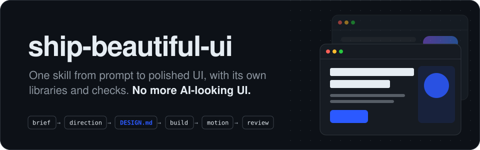

<p align="center">
  
</p>

```bash
npx skills add Vedmeena21/ship-beautiful-ui
```

<p align="center">
  <a href="../../LICENSE"></a>
  <a href="../../skills/ship-beautiful-ui/SKILL.md"></a>
  
  
  <a href="https://github.com/Vedmeena21/ship-beautiful-ui/stargazers"></a>
  <a href="../../translations"></a>
</p>

<p align="center">
  <a href="#instalação">Instalação</a> ·
  <a href="#como-funciona">Como funciona</a> ·
  <a href="#sua-marca-suas-cores">Sua marca, suas cores</a> ·
  <a href="#o-que-tem-dentro">O que tem dentro</a>
</p>

| Primeiro rascunho típico de IA | Feito com ship-beautiful-ui |
|:---:|:---:|
|  |  |

<details>
<summary>🌐 Suporte a vários idiomas</summary>

[English](../../README.md) | [Arabic](../ar/README.md) | [Chinese (Simplified)](../zh/README.md) | [French](../fr/README.md) | [German](../de/README.md) | [Hindi](../hi/README.md) | [Indonesian](../id/README.md) | [Japanese](../ja/README.md) | [Korean](../ko/README.md) | [Portuguese (Brazil)](../pt-BR/README.md) | [Russian](../ru/README.md) | [Spanish](../es/README.md) | [Turkish](../tr/README.md)

</details>

---

## Por que isso existe

Agentes de código escrevem um frontend inteiro em minutos, e mesmo assim ele sai com cara de qualquer outra página feita por IA: a mesma fonte, o mesmo gradiente roxo, a mesma fileira de três cards idênticos, o mesmo fade-up em cada seção.

Isso acontece porque o agente sempre parte dos mesmos padrões. O **ship-beautiful-ui** troca esses padrões por um processo, dados reais de design e verificações que rodam sobre o resultado:

- **Um processo.** Brief → direção → travar → construir → movimento → revisão, sempre nessa ordem.
- **Design a partir do seu tema.** A paleta vem de coisas do próprio mundo do seu produto (a casca e a farinha de uma padaria, o vermelho da luz de segurança de um laboratório fotográfico), não de uma lista que todo mundo usa.
- **Uma única fonte da verdade.** Toda decisão visual é escrita no `DESIGN.md` antes de qualquer código, e verificada.
- **Verificações, não achismo.** Um detector com 40 regras varre o código atrás de sinais de IA e falhas de acessibilidade antes da entrega.

Sem dependências. Os scripts são Python 3 puro.

## Instalação

**Qualquer agente (Claude Code, Codex, Cursor e outros)** pela CLI [`skills`](https://github.com/vercel-labs/skills):

```bash
npx skills add Vedmeena21/ship-beautiful-ui
```

**Plugin do Claude Code:**

```
/plugin marketplace add Vedmeena21/ship-beautiful-ui
/plugin install ship-beautiful-ui@ship-beautiful-ui
```

**Manual:** copie [`skills/ship-beautiful-ui`](../../skills/ship-beautiful-ui) para `.claude/skills/` (projeto) ou `~/.claude/skills/` (global).

**Depois, é só pedir UI.** A skill entra em ação sozinha quando você cria, redesenha ou refina uma página, tela ou componente:

```
Crie uma landing page para uma ferramenta de faturamento para fotógrafos freelancers.
O único objetivo: enviar a primeira fatura em menos de 2 minutos. Next.js + Tailwind.
```

```
Este dashboard parece genérico. Use o ship-beautiful-ui para redesenhá-lo.
```

Você recebe três coisas:

| Entrega | O que é |
|---|---|
| `DESIGN.md` | Seu design system: tokens e regras que qualquer agente consegue ler, com contraste verificado |
| A UI | Construída só com os tokens do `DESIGN.md` |
| `REVIEW.md` | O que o detector encontrou, o que foi corrigido, o que foi mantido e por quê |

## Como funciona

<p align="center">
  
</p>

| Etapa | O que acontece | Incluso |
|---|---|---|
| **0. Brief** | Tema, público, o único objetivo da tela, cinco substantivos do mundo do tema | [`00-brief.md`](../../skills/ship-beautiful-ui/references/00-brief.md) |
| **1. Direção** | Uma paleta, um par tipográfico e um layout feitos para esse tema | `derive.py`, `direction.py`, 78 materiais, 60 paletas, 40 pares, 20 layouts |
| **2. Travar** | Toda decisão escrita no `DESIGN.md` e verificada | `lint_design.py`, [template do `DESIGN.md`](../../skills/ship-beautiful-ui/templates/DESIGN.md) |
| **3. Construir** | Só tokens, uma ideia ousada, o padrão mínimo de qualidade | [`effects.md`](../../skills/ship-beautiful-ui/references/effects.md) (16 efeitos), [`ux-rules.md`](../../skills/ship-beautiful-ui/references/ux-rules.md) (80 regras) |
| **4. Movimento** | Só movimento que explica uma mudança | [`04-motion.md`](../../skills/ship-beautiful-ui/references/04-motion.md): tokens de tempo e 12 receitas |
| **5. Revisão** | Um único portão antes da entrega | `detect.py` (40 regras), capturas de tela, [`REVIEW.md`](../../skills/ship-beautiful-ui/templates/REVIEW.md) |

**Quem vence quando as instruções discordam:** suas palavras > `DESIGN.md` > as regras da skill > qualquer outra coisa carregada. O agente avisa quando resolve um conflito, para você poder contestar.

## Sua marca, suas cores

Diga ao agente o que é o seu produto, e ele faz o design para esse produto, não a partir de uma lista compartilhada. Trabalha em uma empresa com cores de marca? Ele usa essas cores. Ainda não tem marca? Ele escolhe cores que combinam.

- **Você tem uma marca.** Passe suas cores e elas são mantidas exatamente como estão. O agente acrescenta o resto que uma UI de verdade precisa: cores de texto, bordas, hover e erro.
- **Você ainda não tem uma.** Descreva seu produto em poucas palavras e o agente escolhe cores que combinam com o assunto dele.
- **Ainda não tem certeza?** O `direction.py` oferece três visuais prontos para escolher.

De qualquer forma, cada cor é verificada para ser fácil de ler (WCAG AA) antes de escrever qualquer linha de código.

## O que tem dentro

Tudo o que seu agente precisa para fazer design como um profissional, em uma pasta. Sem conta, sem API key, nada extra para instalar.

| O que você recebe | Quantos | Por que importa |
|---|:---:|---|
| Materiais do mundo real | **78** | Cores tiradas de coisas como papel kraft, espresso, musgo e filme, para a paleta combinar com seu produto |
| Paletas de cores | **60** | Prontas para usar, claras e escuras, todas testadas para leitura |
| Pares de fontes | **40** | Uma fonte de título e uma de texto que combinam, todas grátis no Google Fonts |
| Layouts de página | **20** | Estruturas testadas com esboços: hero de produto, editorial, dashboard, preços e mais |
| Efeitos visuais | **16** | Granulado, brilho, holofote, letreiro, inclinação e mais: CSS para copiar e colar que usa suas cores e respeita movimento reduzido |
| Receitas de animação | **12** | Botões, menus, modais, toasts, abas e listas que se movem com o mesmo acabamento |
| Regras de UX | **80** | Um checklist para formulários, navegação, tabelas, gráficos, mobile e estados vazios e de erro |
| Verificações do detector | **40** | Pegam a cara de IA e as falhas de acessibilidade antes de publicar |

## Licença

[MIT](../../LICENSE). Criado e mantido por **Ved Prakash Meena**.

<a href="https://www.linkedin.com/in/ved-prakash-meena"></a>

<p align="center">
  <sub>Se isso te poupou uma rodada de "deixa com menos cara de IA", uma ⭐ ajuda outras pessoas a encontrar, e <a href="https://www.linkedin.com/in/ved-prakash-meena">me siga no LinkedIn</a> para mais.</sub>
</p>
