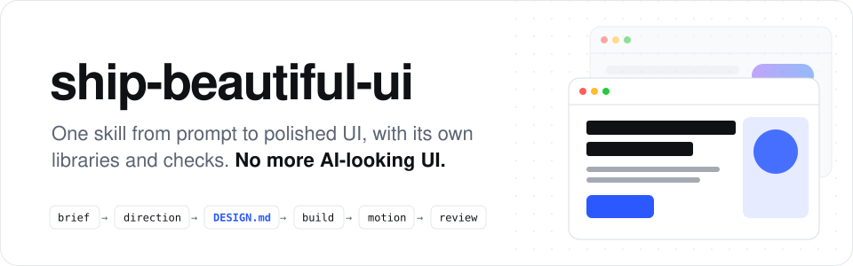

<p align="center">
  <picture>
    <source media="(prefers-color-scheme: dark)" srcset="../../assets/readme/header-dark.svg">
    
  </picture>
</p>

<p align="center">
  <b>Один skill, который ведёт вашего агента от промпта до отточенного UI.<br>Свои дизайн-библиотеки, свои проверки и дизайн, который рождается из вашей темы, а не из шаблона.</b>
</p>

<p align="center">
  <a href="../../LICENSE"></a>
  <a href="../../skills/ship-beautiful-ui/SKILL.md"></a>
  
  
  <a href="https://github.com/Vedmeena21/ship-beautiful-ui/stargazers"></a>
  <a href="https://www.linkedin.com/in/ved-prakash-meena"></a>
</p>

<p align="center">
  <a href="#установка">Установка</a> ·
  <a href="#как-это-работает">Как это работает</a> ·
  <a href="#принесите-свой-бренд-цвета-он-подберёт-сам">Принесите свой бренд. Цвета он подберёт сам.</a> ·
  <a href="#что-внутри">Что внутри</a> ·
  <a href="#детектор">Детектор</a>
</p>

| Типичный первый черновик от ИИ | Сделано с ship-beautiful-ui |
|:---:|:---:|
|  |  |

### 🌐 Поддержка нескольких языков

[English](../../README.md) | [Arabic](../ar/README.md) | [Chinese (Simplified)](../zh/README.md) | [French](../fr/README.md) | [German](../de/README.md) | [Hindi](../hi/README.md) | [Indonesian](../id/README.md) | [Japanese](../ja/README.md) | [Korean](../ko/README.md) | [Portuguese (Brazil)](../pt-BR/README.md) | [Russian](../ru/README.md) | [Spanish](../es/README.md) | [Turkish](../tr/README.md)

---

## Зачем это нужно

Агенты для кода пишут целый фронтенд за минуты, но результат всё равно выглядит как любая другая страница, сделанная ИИ: тот же шрифт, тот же фиолетовый градиент, тот же ряд из трёх одинаковых карточек, тот же fade-up в каждой секции.

Так происходит, потому что агент каждый раз начинает с одних и тех же настроек по умолчанию. **ship-beautiful-ui** заменяет их процессом, реальными дизайн-данными и проверками, которые запускаются на результате:

- **Процесс.** Бриф → направление → фиксация → сборка → анимация → ревью, всегда в этом порядке.
- **Дизайн из вашей темы.** Палитра берётся из мира вашего продукта (корочка и мука пекарни, красный свет фотолаборатории), а не из общего для всех списка.
- **Единый источник правды.** Каждое визуальное решение записывается в `DESIGN.md` до написания кода и проверяется.
- **Проверки, а не ощущения.** Детектор из 40 правил ищет в коде признаки ИИ и проблемы доступности перед сдачей.

Никаких зависимостей. Скрипты написаны на чистом Python 3.

## Установка

**Любой агент (Claude Code, Codex, Cursor и другие)** через CLI [`skills`](https://github.com/vercel-labs/skills):

```bash
npx skills add Vedmeena21/ship-beautiful-ui
```

**Плагин для Claude Code:**

```
/plugin marketplace add Vedmeena21/ship-beautiful-ui
/plugin install ship-beautiful-ui@ship-beautiful-ui
```

**Вручную:** скопируйте [`skills/ship-beautiful-ui`](../../skills/ship-beautiful-ui) в `.claude/skills/` (проект) или `~/.claude/skills/` (глобально).

**Потом просто попросите UI.** Skill запускается сам, когда вы создаёте, переделываете или дорабатываете страницу, экран или компонент:

```
Сделай лендинг для сервиса счетов для фотографов-фрилансеров.
Единственная задача: отправить первый счёт меньше чем за 2 минуты. Next.js + Tailwind.
```

```
Этот дашборд выглядит шаблонно. Переделай его с помощью ship-beautiful-ui.
```

Вы получаете три вещи:

| Результат | Что это |
|---|---|
| `DESIGN.md` | Ваша дизайн-система: токены и правила, понятные любому агенту, с проверенным контрастом |
| UI | Собран только из токенов `DESIGN.md` |
| `REVIEW.md` | Что нашёл детектор, что исправлено, что оставлено и почему |

## Как это работает

<p align="center">
  
</p>

| Шаг | Что происходит | Встроено |
|---|---|---|
| **0. Бриф** | Тема, аудитория, единственная задача экрана, пять существительных из мира темы | [`00-brief.md`](../../skills/ship-beautiful-ui/references/00-brief.md) |
| **1. Направление** | Палитра, пара шрифтов и макет, созданные для этой темы | `derive.py`, `direction.py`, 78 материалов, 60 палитр, 40 пар шрифтов, 20 макетов |
| **2. Фиксация** | Каждое решение записано в `DESIGN.md` и проверено | `lint_design.py`, [шаблон `DESIGN.md`](../../skills/ship-beautiful-ui/templates/DESIGN.md) |
| **3. Сборка** | Только токены, одна смелая идея, минимальная планка качества | [`effects.md`](../../skills/ship-beautiful-ui/references/effects.md) (16 эффектов), [`ux-rules.md`](../../skills/ship-beautiful-ui/references/ux-rules.md) (80 правил) |
| **4. Анимация** | Только анимация, которая объясняет изменение | [`04-motion.md`](../../skills/ship-beautiful-ui/references/04-motion.md): токены времени и 12 рецептов |
| **5. Ревью** | Одна проверка перед сдачей | `detect.py` (40 правил), скриншоты, [`REVIEW.md`](../../skills/ship-beautiful-ui/templates/REVIEW.md) |

**Кто главный, если инструкции расходятся:** ваши слова > `DESIGN.md` > правила skill > всё остальное. Агент прямо говорит, когда разрешает конфликт, чтобы вы могли его поправить.

## Принесите свой бренд. Цвета он подберёт сам.

Работаете в Microsoft? Скажите об этом, и каждая страница будет собрана из цветов Microsoft: синий для действий, ваши нейтральные для текста и оттенки, которые нужны настоящему UI. Бренда пока нет? Опишите мир вашего продукта в нескольких словах, и он соберёт палитру за вас.

| Вы говорите | Вы получаете |
|---|---|
| *Мы работаем в Microsoft. Используй наши синий, зелёный, красный и жёлтый.* | Именно эти цвета на кнопках, акцентах и выделениях, плюс подходящие оттенки для текста, рамок, наведения и ошибок |
| *Приложение для счетов фотографов: фотолаборатория, красный фонарь, плёнка* | Страница цвета фотобумаги, глубокий чёрный текст, кнопки цвета красного фонаря, янтарные детали плёнки (страница «после» выше) |
| *Пекарня: корочка, мука, эспрессо, шафран* | Страница цвета муки, текст цвета эспрессо, кнопки цвета корочки, шафрановые акценты |

Каждый цвет проверяется на читаемость (WCAG AA) до первой строки кода. Темы пока нет? `direction.py` предложит три готовых направления на выбор.

## Что внутри

Всё, что нужно вашему агенту, чтобы проектировать как профи, в одной папке. Без аккаунтов, без API-ключей, без дополнительных установок.

| Что вы получаете | Сколько | Зачем это нужно |
|---|:---:|---|
| Материалы из реального мира | **78** | Цвета крафтовой бумаги, эспрессо, мха, плёнки и другого, чтобы палитра подходила вашему продукту |
| Цветовые палитры | **60** | Готовы к использованию, светлые и тёмные, каждая проверена на читаемость |
| Пары шрифтов | **40** | Шрифт для заголовков и для текста, которые сочетаются, все бесплатные в Google Fonts |
| Макеты страниц | **20** | Проверенные структуры страниц с эскизами: продуктовый первый экран, редакционный, дашборд, цены и другие |
| Визуальные эффекты | **16** | Зерно, свечение, прожектор, бегущая строка, наклон и другие: CSS для копирования, который берёт ваши цвета и учитывает настройку уменьшения движения |
| Рецепты анимации | **12** | Кнопки, меню, модальные окна, уведомления, вкладки и списки двигаются одинаково аккуратно |
| Правила UX | **80** | Чек-лист для форм, навигации, таблиц, графиков, мобильной версии, пустых состояний и ошибок |
| Проверки детектора | **40** | Находят «ИИ-вид» и проблемы доступности до релиза |

### Четыре инструмента, которые делают работу

| Инструмент | Что он делает для вас |
|---|---|
| `derive.py` | Опишите продукт в нескольких словах и получите подходящую палитру |
| `direction.py` | Не знаете, с чего начать? Получите 3 направления дизайна на выбор, сохранённые как `DESIGN.md` |
| `lint_design.py` | Проверяет, что ваш `DESIGN.md` полон, а каждый цвет читаем |
| `detect.py` | Ищет в коде (HTML, CSS, React, Vue, Svelte, Astro) 40 признаков UI, сделанного ИИ |

## Детектор

```
$ python3 scripts/detect.py src/
SBU001 warning One generic sans for everything
SBU002 warning Purple-to-blue gradient
SBU010 error   Motion without reduced-motion support
SBU011 error   Focus outline removed
SBU013 warning Cream page + terracotta accent
...
Scanned 1 files: 6 errors, 10 warnings, 5 info
```

К каждой находке прилагается исправление. Ошибки блокируют сдачу; предупреждения исправляются или получают письменное объяснение в `REVIEW.md`. Полный список, плюс 12 визуальных шаблонов, которые агент проверяет на глаз, находится в [`anti-patterns.md`](../../skills/ship-beautiful-ui/references/anti-patterns.md).

## Лицензия

[MIT](../../LICENSE). Создан и поддерживается **Ved Prakash Meena**.

<a href="https://www.linkedin.com/in/ved-prakash-meena"></a>

<p align="center">
  <sub>Если это сэкономило вам раунд «сделай, чтобы было меньше похоже на ИИ», ⭐ поможет другим найти проект, а за новыми материалами <a href="https://www.linkedin.com/in/ved-prakash-meena">подписывайтесь в LinkedIn</a>.</sub>
</p>
