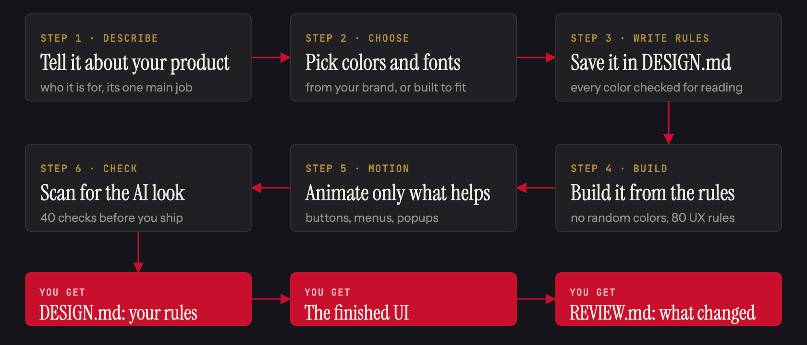

<p align="center">
  
</p>

<p align="center">
  <b>Kodlama ajanınızı prompt'tan özenle hazırlanmış bir arayüze götüren tek bir skill.<br>Kendi tasarım kütüphaneleri, kendi kontrolleri ve şablondan değil, konunuzdan doğan tasarımlar.</b>
</p>

```bash
npx skills add Vedmeena21/ship-beautiful-ui
```

<p align="center">
  <a href="../../LICENSE"></a>
  <a href="../../skills/ship-beautiful-ui/SKILL.md"></a>
  
  
  <a href="https://github.com/Vedmeena21/ship-beautiful-ui/stargazers"></a>
  <a href="../../translations"></a>
</p>

<p align="center">
  <a href="#kurulum">Kurulum</a> ·
  <a href="#nasıl-çalışır">Nasıl çalışır</a> ·
  <a href="#markan-renklerin">Markan, renklerin</a> ·
  <a href="#i̇çinde-neler-var">İçinde neler var</a>
</p>

| Tipik yapay zeka ilk taslağı | ship-beautiful-ui ile yapıldı |
|:---:|:---:|
|  |  |

<details>
<summary>🌐 Çoklu dil desteği</summary>

[English](../../README.md) | [Arabic](../ar/README.md) | [Chinese (Simplified)](../zh/README.md) | [French](../fr/README.md) | [German](../de/README.md) | [Hindi](../hi/README.md) | [Indonesian](../id/README.md) | [Japanese](../ja/README.md) | [Korean](../ko/README.md) | [Portuguese (Brazil)](../pt-BR/README.md) | [Russian](../ru/README.md) | [Spanish](../es/README.md) | [Turkish](../tr/README.md)

</details>

---

## Neden var

Kodlama ajanları dakikalar içinde koca bir frontend yazabiliyor, ama sonuç yine yapay zekayla yapılmış diğer tüm sayfalara benziyor: aynı yazı tipi, aynı mor gradyan, aynı üç özdeş kartlık sıra, her bölümde aynı fade-up.

Bunun nedeni ajanın her seferinde aynı varsayılanlarla başlaması. **ship-beautiful-ui** bu varsayılanların yerine bir süreç, gerçek tasarım verisi ve sonuç üzerinde çalışan kontroller koyar:

- **Bir süreç.** Brief → yön → kilitleme → geliştirme → hareket → inceleme, her zaman bu sırayla.
- **Konunuzdan tasarım.** Palet, herkesin paylaştığı bir listeden değil, ürününüzün kendi dünyasındaki şeylerden gelir (bir fırının kabuğu ve unu, bir karanlık odanın güvenli ışık kırmızısı).
- **Tek doğru kaynak.** Her görsel karar, kod yazılmadan önce `DESIGN.md` içine yazılır ve kontrol edilir.
- **His değil, kontrol.** 40 kurallı bir dedektör, teslimden önce koddaki yapay zeka izlerini ve erişilebilirlik eksiklerini tarar.

Bağımlılık yok. Scriptler düz Python 3.

## Kurulum

**Herhangi bir ajan (Claude Code, Codex, Cursor ve daha fazlası)** [`skills`](https://github.com/vercel-labs/skills) CLI ile:

```bash
npx skills add Vedmeena21/ship-beautiful-ui
```

**Claude Code eklentisi:**

```
/plugin marketplace add Vedmeena21/ship-beautiful-ui
/plugin install ship-beautiful-ui@ship-beautiful-ui
```

**Elle:** [`skills/ship-beautiful-ui`](../../skills/ship-beautiful-ui) klasörünü `.claude/skills/` (proje) veya `~/.claude/skills/` (genel) içine kopyalayın.

**Sonra sadece arayüz isteyin.** Bir sayfa, ekran veya bileşen oluştururken, yeniden tasarlarken ya da cilalarken skill kendiliğinden devreye girer:

```
Serbest çalışan fotoğrafçılar için bir fatura aracının açılış sayfasını yap.
Tek amaç: ilk faturayı 2 dakikadan kısa sürede göndermek. Next.js + Tailwind.
```

```
Bu dashboard sıradan görünüyor. Yeniden tasarlamak için ship-beautiful-ui kullan.
```

Üç şey geri alırsınız:

| Çıktı | Nedir |
|---|---|
| `DESIGN.md` | Tasarım sisteminiz: her ajanın okuyabileceği token'lar ve kurallar, kontrastı kontrol edilmiş |
| Arayüz | Yalnızca `DESIGN.md` token'larıyla oluşturulur |
| `REVIEW.md` | Dedektörün bulduğu, düzeltilen, bırakılan şeyler ve nedenleri |

## Nasıl çalışır

<p align="center">
  
</p>

| Adım | Ne olur | Dahili |
|---|---|---|
| **0. Brief** | Konu, hedef kitle, ekranın tek görevi, konunun dünyasından beş isim | [`00-brief.md`](../../skills/ship-beautiful-ui/references/00-brief.md) |
| **1. Yön** | Bu konu için hazırlanmış bir palet, yazı tipi çifti ve düzen | `derive.py`, `direction.py`, 78 malzeme, 60 palet, 40 yazı tipi çifti, 20 düzen |
| **2. Kilitleme** | Her karar `DESIGN.md` içine yazılır ve kontrol edilir | `lint_design.py`, [`DESIGN.md` şablonu](../../skills/ship-beautiful-ui/templates/DESIGN.md) |
| **3. Geliştirme** | Yalnızca token'lar, tek cesur fikir, kalite tabanı | [`effects.md`](../../skills/ship-beautiful-ui/references/effects.md) (16 efekt), [`ux-rules.md`](../../skills/ship-beautiful-ui/references/ux-rules.md) (80 kural) |
| **4. Hareket** | Yalnızca bir değişikliği açıklayan hareket | [`04-motion.md`](../../skills/ship-beautiful-ui/references/04-motion.md): zamanlama token'ları ve 12 tarif |
| **5. İnceleme** | Tesliminden önce tek bir kapı | `detect.py` (40 kural), ekran görüntüleri, [`REVIEW.md`](../../skills/ship-beautiful-ui/templates/REVIEW.md) |

**Talimatlar çeliştiğinde kim kazanır:** sizin sözleriniz > `DESIGN.md` > skill'in kuralları > yüklenen diğer her şey. Ajan bir çelişkiyi çözdüğünde bunu açıkça söyler, böylece onu geçersiz kılabilirsiniz.

## Markan, renklerin

Ajana ürününün ne olduğunu söyle; herkesin kullandığı ortak bir listeden değil, o ürün için tasarlasın. Marka renkleri olan bir şirkette mi çalışıyorsun? Onları kullanır. Henüz markan yok mu? Uygun renkleri seçer.

- **Bir markan var.** Renklerini paylaş, olduğu gibi korunur. Gerçek bir arayüzün ihtiyaç duyduğu geri kalanı ajan ekler: metin, kenarlık, üzerine gelme ve hata renkleri.
- **Henüz yok.** Ürününü birkaç kelimeyle anlat, ajan konusuna uygun renkleri seçsin.
- **Emin değil misin?** `direction.py` aralarından seçebileceğin üç hazır görünüm sunar.

Hangisi olursa olsun, tek satır kod yazılmadan önce her rengin kolay okunduğu (WCAG AA) kontrol edilir.

## İçinde neler var

Ajanınızın profesyonel gibi tasarlaması için gereken her şey tek bir klasörde. Hesap yok, API anahtarı yok, ekstra kurulacak bir şey yok.

| Ne alırsınız | Kaç tane | Neden önemli |
|---|:---:|---|
| Gerçek dünya malzemeleri | **78** | Kraft kağıdı, espresso, yosun ve film gibi şeylerden alınan renkler, böylece palet ürününüze uyar |
| Renk paletleri | **60** | Kullanıma hazır, açık ve koyu, her biri okunabilirlik için test edilmiş |
| Yazı tipi çiftleri | **40** | Birlikte iyi çalışan bir başlık ve bir metin yazı tipi, hepsi Google Fonts'ta ücretsiz |
| Sayfa düzenleri | **20** | Taslaklarıyla kanıtlanmış sayfa yapıları: ürün hero'su, editoryal, dashboard, fiyatlandırma ve daha fazlası |
| Görsel efektler | **16** | Gren, parıltı, spot ışığı, kayan yazı, eğim ve daha fazlası: renklerinizi alan ve azaltılmış hareket ayarına saygı duyan kopyala-yapıştır CSS |
| Animasyon tarifleri | **12** | Düğmeler, menüler, modallar, toast'lar, sekmeler ve listeler hep aynı özenli şekilde hareket eder |
| UX kuralları | **80** | Formlar, gezinme, tablolar, grafikler, mobil, boş ve hata durumları için bir kontrol listesi |
| Dedektör kontrolleri | **40** | Yayına almadan önce yapay zeka görünümünü ve erişilebilirlik eksiklerini yakalar |

## Lisans

[MIT](../../LICENSE). **Ved Prakash Meena** tarafından geliştirilmiş ve sürdürülmektedir.

<a href="https://www.linkedin.com/in/ved-prakash-meena"></a>

<p align="center">
  <sub>Bu size bir "daha az yapay zeka gibi görünsün" turundan tasarruf ettirdiyse, bir ⭐ başkalarının onu bulmasına yardım eder, daha fazlası için <a href="https://www.linkedin.com/in/ved-prakash-meena">beni LinkedIn'de takip edin</a>.</sub>
</p>
