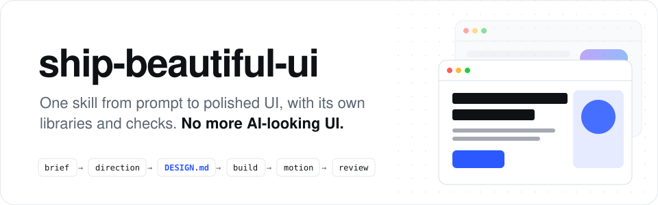
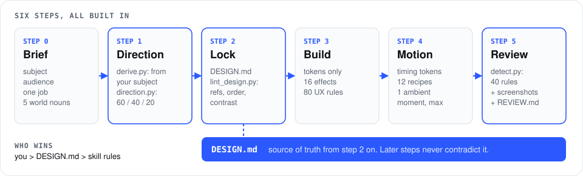

<p align="center">
  <picture>
    <source media="(prefers-color-scheme: dark)" srcset="../../assets/readme/header-dark.svg">
    
  </picture>
</p>

<p align="center">
  <b>一个 skill，让你的编程智能体从提示词直达精致的 UI。<br>自带设计库、自带检查，设计源自你的主题，而不是模板。</b>
</p>

<p align="center">
  <a href="../../LICENSE"></a>
  <a href="../../skills/ship-beautiful-ui/SKILL.md"></a>
  
  
  <a href="https://github.com/Vedmeena21/ship-beautiful-ui/stargazers"></a>
  <a href="https://www.linkedin.com/in/ved-prakash-meena"></a>
</p>

<p align="center">
  <a href="#安装">安装</a> ·
  <a href="#工作原理">工作原理</a> ·
  <a href="#你的品牌你的配色">你的品牌，你的配色</a> ·
  <a href="#里面有什么">里面有什么</a>
</p>

| 典型的 AI 初稿 | 用 ship-beautiful-ui 构建 |
|:---:|:---:|
|  |  |

### 🌐 多语言支持

[English](../../README.md) | [Arabic](../ar/README.md) | [Chinese (Simplified)](../zh/README.md) | [French](../fr/README.md) | [German](../de/README.md) | [Hindi](../hi/README.md) | [Indonesian](../id/README.md) | [Japanese](../ja/README.md) | [Korean](../ko/README.md) | [Portuguese (Brazil)](../pt-BR/README.md) | [Russian](../ru/README.md) | [Spanish](../es/README.md) | [Turkish](../tr/README.md)

---

## 为什么做这个

编程智能体几分钟就能写出完整的前端，但结果看起来和其他 AI 页面一模一样：同样的字体、同样的紫色渐变、同样一排三张相同的卡片、每个区块同样的淡入上移动画。

原因是智能体每次都从同样的默认值开始。**ship-beautiful-ui** 用一套流程、真实的设计数据和对结果的检查来取代这些默认值：

- **一套流程。** 需求 → 方向 → 锁定 → 构建 → 动效 → 审查，始终按这个顺序。
- **从你的主题出发做设计。** 配色来自你产品自己的世界（面包店的面包皮和面粉、暗房安全灯的红色），而不是大家共用的列表。
- **唯一的事实来源。** 每个视觉决定都在写代码前记入 `DESIGN.md`，并经过检查。
- **用检查说话，而不是凭感觉。** 交付前，一个 40 条规则的检测器会扫描代码中的 AI 痕迹和无障碍问题。

零依赖。脚本是纯 Python 3。

## 安装

**任意智能体（Claude Code、Codex、Cursor 等）** 通过 [`skills`](https://github.com/vercel-labs/skills) CLI：

```bash
npx skills add Vedmeena21/ship-beautiful-ui
```

**Claude Code 插件：**

```
/plugin marketplace add Vedmeena21/ship-beautiful-ui
/plugin install ship-beautiful-ui@ship-beautiful-ui
```

**手动安装：** 将 [`skills/ship-beautiful-ui`](../../skills/ship-beautiful-ui) 复制到 `.claude/skills/`（项目级）或 `~/.claude/skills/`（全局）。

**然后直接让它做 UI。** 当你构建、重新设计或打磨页面、屏幕或组件时，skill 会自动启动：

```
为一款面向自由摄影师的开票工具做一个落地页。
唯一目标：2 分钟内发出第一张发票。Next.js + Tailwind。
```

```
这个仪表盘看起来太普通了。用 ship-beautiful-ui 重新设计它。
```

你会得到三样东西：

| 产出 | 是什么 |
|---|---|
| `DESIGN.md` | 你的设计系统：任何智能体都能读懂的 token 和规则，已检查对比度 |
| UI | 只用 `DESIGN.md` 中的 token 构建 |
| `REVIEW.md` | 检测器发现了什么、修复了什么、保留了什么以及原因 |

## 工作原理

<p align="center">
  
</p>

| 步骤 | 做什么 | 内置 |
|---|---|---|
| **0. 需求** | 主题、受众、这个页面唯一的任务、来自主题世界的五个名词 | [`00-brief.md`](../../skills/ship-beautiful-ui/references/00-brief.md) |
| **1. 方向** | 为这个主题定制的配色、字体搭配和布局 | `derive.py`, `direction.py`, 78 种材质、60 套配色、40 组字体搭配、20 种布局 |
| **2. 锁定** | 每个决定都写入 `DESIGN.md` 并检查 | `lint_design.py`, [`DESIGN.md` 模板](../../skills/ship-beautiful-ui/templates/DESIGN.md) |
| **3. 构建** | 只用 token，一个大胆的想法，守住质量底线 | [`effects.md`](../../skills/ship-beautiful-ui/references/effects.md) (16 种效果), [`ux-rules.md`](../../skills/ship-beautiful-ui/references/ux-rules.md) (80 条规则) |
| **4. 动效** | 只保留能解释变化的动效 | [`04-motion.md`](../../skills/ship-beautiful-ui/references/04-motion.md): 时间 token 和 12 个配方 |
| **5. 审查** | 交付前的一道关卡 | `detect.py` (40 条规则), 截图, [`REVIEW.md`](../../skills/ship-beautiful-ui/templates/REVIEW.md) |

**指令冲突时谁说了算：** 你的话 > `DESIGN.md` > skill 的规则 > 其他任何加载的内容。智能体在解决冲突时会明确说出来，方便你推翻它。

## 你的品牌，你的配色

告诉智能体你的产品是什么，它就为这个产品做设计，而不是从大家共用的列表里挑。在有品牌色的公司工作？它会直接使用。还没有品牌？它会挑选合适的颜色。

- **你有品牌。** 提供你的颜色，它们会原样保留。智能体再补上真实 UI 还需要的颜色：文字、边框、悬停和错误状态。
- **你还没有品牌。** 用几个词描述你的产品，智能体会挑选与之契合的颜色。
- **还没想好？** `direction.py` 提供三种现成的风格供你选择。

无论哪种方式，在写下一行代码之前，每个颜色都会经过易读性检查（WCAG AA）。

## 里面有什么

让你的智能体像专业设计师一样工作所需的一切，都在一个文件夹里。无需账号，无需 API 密钥，无需额外安装。

| 你得到 | 数量 | 有什么用 |
|---|:---:|---|
| 真实世界的材质 | **78** | 颜色取自牛皮纸、浓缩咖啡、苔藓、胶片等事物，让配色贴合你的产品 |
| 配色方案 | **60** | 开箱即用，有浅色和深色，每一套都经过可读性测试 |
| 字体搭配 | **40** | 标题字体和正文字体搭配好了，全部是免费的 Google Fonts |
| 页面布局 | **20** | 经过验证的页面结构并附草图：产品首屏、杂志风、仪表盘、定价页等 |
| 视觉效果 | **16** | 颗粒、光晕、聚光灯、跑马灯、倾斜等：可直接复制的 CSS，自动套用你的颜色并尊重减少动态效果设置 |
| 动画配方 | **12** | 按钮、菜单、弹窗、提示、标签页和列表，都以同样精致的方式运动 |
| UX 规则 | **80** | 一份清单，覆盖表单、导航、表格、图表、移动端以及空状态和错误状态 |
| 检测器检查项 | **40** | 在上线前揪出 AI 味和无障碍问题 |

## 许可证

[MIT](../../LICENSE). 由 **Ved Prakash Meena** 构建和维护。

<a href="https://www.linkedin.com/in/ved-prakash-meena"></a>

<p align="center">
  <sub>如果它帮你省掉了一轮“让它看起来别那么像 AI”，点个 ⭐ 能帮更多人找到它，也欢迎<a href="https://www.linkedin.com/in/ved-prakash-meena">在 LinkedIn 上关注我</a>获取更多内容。</sub>
</p>
